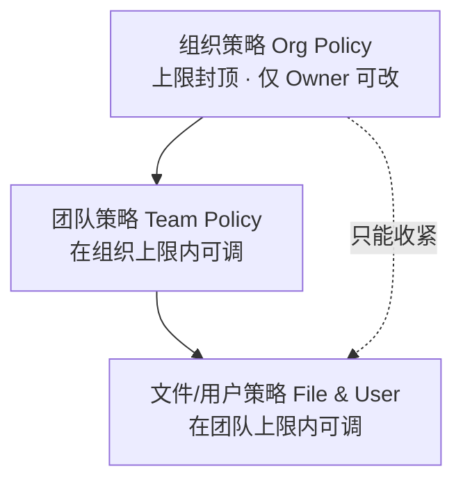
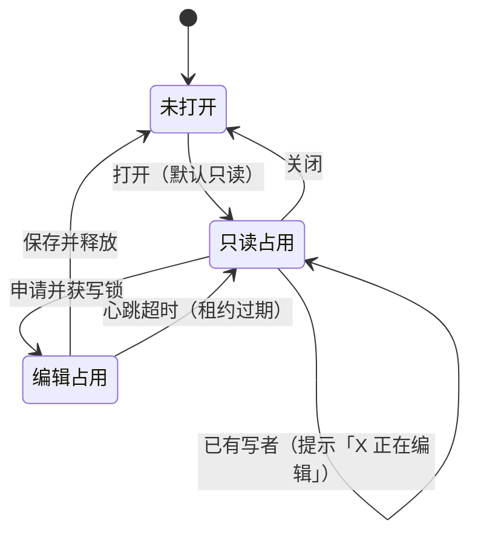
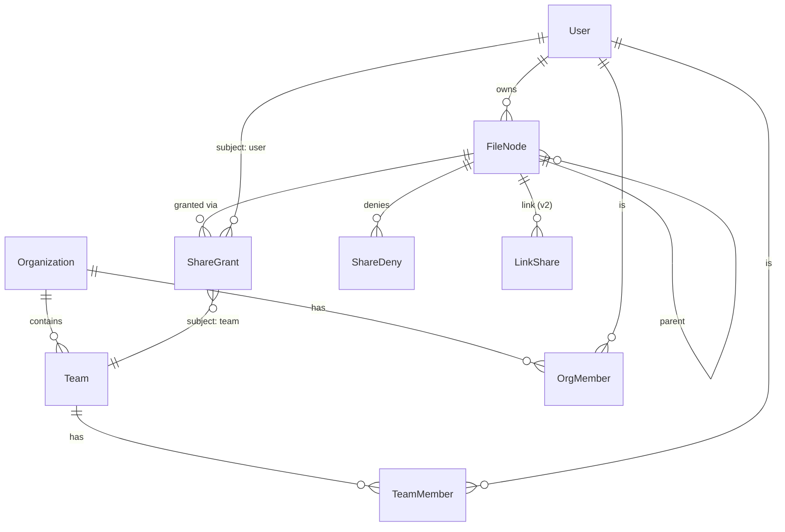
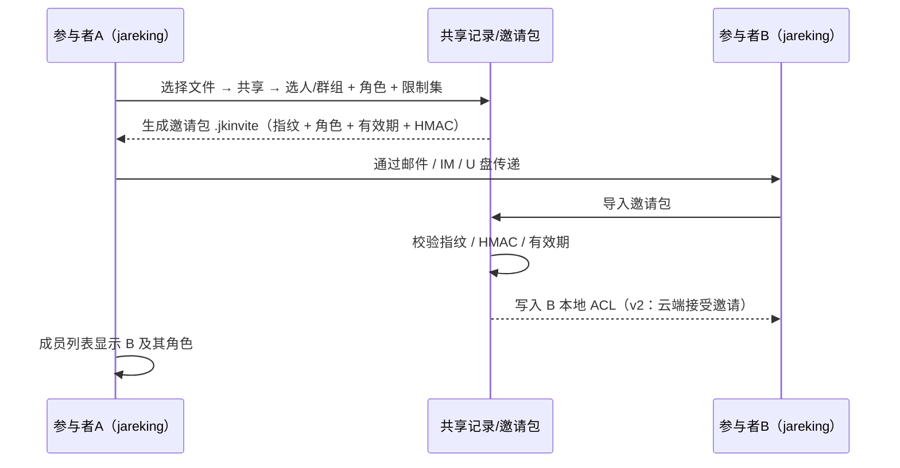
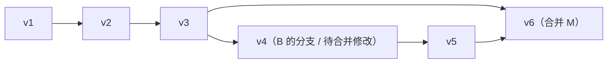

# 云端共享与权限配置 —— 增量 PRD

> 文档编号 **PRD-002** · 版本 **v0.4（契约定稿）** · 日期 **2026-10-17** · 产品：许清楚
> 状态：**权限契约已定稿（v0.4，可进入实现与基线落地）**；业务类仍有 Q1–Q4、Q6–Q10 待拍板（Q5 已定 A、Q11 已定 B，见第 10 章）
> 关联：`docs/spec.md`（4.7 账号与云同步 · 6.5 个人开发者路径 · 7.4 后端预留）、`docs/todo.md`（CS 系列）、`docs/tasks-cs-p0.md`（工程卡）、`docs/wps-parity.md`（原则 3）
> 一句话：**jareking v1 无云。本文是「面向未来的设计」，用「本机 → 局域网 → 云端」三级落地，先把"文件被谁改过、谁能改、怎么合"这三件事说清楚。**

---

## 修订说明（v0.3，2026-10-17 主理人拍板）

> 本节为**唯一权威变更记录**。v0.3 含 **9 点**变更，全部来自 QA 两轮可测性评审 + 主理人裁决（第 1–5 点为第一轮，第 6–9 点为 QA 复核后同日追加）；其余章节内容与 v0.2 一致。

| # | 变更 | 裁决 / 依据 | 落点 |
|---|---|---|---|
| **1** | **Q5 拍板：deny 不可逆（选 A）**。子级**不得**重新允许父级显式 Deny。 | 主理人裁决：**fail-closed 更安全**，与本文「显式 Deny 优先」一致，也符合组织合规诉求（若允许子级恢复，组织强制禁项会被逐层绕开） | §4.4 算法 + 关键约定 #2 + §4.3 层级语义；§4.4.2 断链语义；§10 Q5（标记已拍板）；用例 **4 / 15 / 17** 期望值**写死** |
| **2** | **契约补 `via` 访问上下文**：`resolvePermissions` 新增第 3 个必需入参，区分「成员身份访问」与「链接访问」。 | QA：原签名 `(user, chain)` 无法区分访问路径 → **用例 6/8 无法实现** | §4.4 输入/算法；§4.4.1 `allowSetVia`；§12.2 契约（`ShareVia` / `resolveAccess`） |
| **3** | **补 `RoleCaps`（role → capability 映射表）并纳入契约**。 | QA：grant 是**角色粒度**、deny 是**能力粒度**，缺表则 union / 差集**无定义** | §4.4.1；§12.2 契约（`capabilitiesOf` / `allowSet` / `ROLE_ORDER` / `ShareRoleLevel`）；拟落 `packages/core/src/contracts/sharing.ts`（AGENTS 铁律 1.1） |
| **4** | **修正 §4.4 伪码两处 P0 越权缺陷**：①`policyCap` 封顶写在循环外、只用了最后一跳 → **祖先策略被忽略**；②`policyCap.denied` 强制禁项**从未被应用** → 组织禁 print/export **失效**。 | QA 评审（工程照抄即带上 P0 越权） | §4.4 算法改为「**先累积、最后一次性求交与作差**」；§4.4 下「P0 级实现约束」扩为 **5 条**（另补：链接通路门控、effective cap） |
| **5** | **`allowSet(maxRole)` 定为「档位上限」语义**：`maxRole='commenter'` ⇒ 允许 commenter **及其下级 viewer** 的能力。 | 主理人裁决：按产品读法执行；表格严格单调 ⇒ 两种读法数值等价 | §4.4.1 派生定义；用例 5/9 |
| **6** | **【P0】`policyCap` 定为 `effective` 语义**（= 已按 §2.2 三级 min 求过的有效上限，**非 raw**）。 | 主理人裁定（采纳 QA 推荐）：堵「**grant 回弹**」——若存 raw，深层节点 grant 会把祖先封顶/禁项 union 回来（用例 9 实算成 editor、用例 10 的 print/export 被加回） | §4.4 输入（语义定义）+ 约束 ⑤；§12.2 `SharePolicyCap` 注释；用例 9/10/25 |
| **7** | **`detachedFromParent` 收紧为「只切断 grants，祖先 denies 与 policyCap 继续生效」**（原 v0.2 为"grants 与 denies 一并切断"）。 | 主理人裁定 + QA：detach 只解除「**授权继承**」，不解除「**禁止**」；否则 detach 一下即可绕开组织强制禁令 → 与 Q5=A 矛盾 | §4.4.2 ②；§4.5 二次确认文案；用例 17/25；契约 `buildChain` 注释 |
| **8** | **【P1】缓存键补 `via.id`（及 `passwordOk`）**。 | QA：不同链接的求值结果不同，键里不含 `via.id` 会把 A 链接结果串给 B 链接 → **缓存串权** | §4.4 关键约定 #7 |
| **9** | **补 3 处产品级漏洞**：①`capabilitiesOf('none')=∅` 显式化 + RoleCaps 加 `none` 列；②成员经链接进入取**两通路并集**（防"成员被链接降权"）；③新增 **Q11**：公网链接默认禁下载/打印/导出。 | ①②QA 复核建议；③QA 安全评审提醒（产品取舍） | §4.4.1（`none` 列 + `ShareRoleLevel`）；§4.4 关键约定 #8 + `resolveAccess`；§10 Q11；用例 21–24 |

> **v0.3 与主理人指令的对应**：指令中的「17 用例」在追加第 6–9 点后扩为 **25 条**（原 17 条无删改，仅 9/10/17 的期望写法更严格，另新增 21–25）。

### v0.4 变更（QA 基线落地时暴露的 7 项参考模型 ↔ 契约偏差）

> 以下 **D1–D7 均为 v0.3 的**契约内部不一致**，不推翻 §4.4 的算法结构**（QA 已验证 34/34 基线全绿，并用突变控制证明四条越权断言非空转）。

| # | 级别 | 问题 | 定稿处理 |
|---|---|---|---|
| **D1** | **P1 阻断** | `passwordOk` 三处口径冲突：约束④写 `!== true ⇒ ∅`、§4.4.1 写 `=== false ⇒ ∅`、类型为可选；而**用例 8 未传**（undefined）→ 按前者得 ∅，与期望 `commenterCaps` 矛盾 | **改为必需 `passwordOk: boolean`**，全文统一 `!== true ⇒ ∅`；**无密码链接由调用方显式填 `true`**。理由：`!== false 放行` 会让"调用方漏传参"变成**静默绕过密码**，与 Q5=A 的 fail-closed 取向相反；必需 boolean 让漏传在 **typecheck 阶段**就红。用例 8 补 `passwordOk: true`，用例 20 为 `false` |
| **D2** | **P1 阻断** | `ShareCapability` 联合只有 **10 项**，而 §4.4.1 表列 **11 项**（含 `transferOwnership`）→ `capabilitiesOf` 引用未声明成员，**typecheck 必红** | **保留表项、补齐类型**（不是删表）：`transferOwnership` 是真实产品能力（转移所有权，仅 Owner），删掉等于从契约里抹掉该能力。`ShareCapability` 补为 11 项 |
| **D3** | **P1** | **双事实源**：`linkPolicy.role` 与 `grants[{kind:'link'}]` 都能授予链接角色，而算法只读 `grants`；若工程按 `linkPolicy.role` 存，用例 8 直接得空集（违反 AGENTS 铁律 1.1） | **删掉 `linkPolicy.role`**，钉死单一来源：**授权只走 `grants`**（链接用 `{kind:'link'; id}`，公网用 `{kind:'anyone'}`）；`linkPolicy` **只承载约束**（`scope` / `password` / `expiresAt` / `deny`）。这样授权与约束各一个入口，算法无需改动 |
| **D4** | **P1** | **假安全**：`linkPolicy.deny` 与 `expiresAt` 声明了但算法从不应用 → 链接级"禁下载"与"链接过期"均可绕过 | **真正并入算法**：匹配到链接时 `denied \|= linkPolicy.deny`；`expiresAt !== undefined && ctx.now >= expiresAt ⇒ 直接 ∅`（fail-closed）；`scope='anyone'` 时按 Q11 强制注入 `deny=[download,export,print]` |
| **D5** | P2 | `buildChain` 方案 A（返回 `detachIndex`）**无处安放**——签名是 `ShareNode[]` | **写死选方案 B**：`buildChain` 直接**清空断点以上祖先的 `grants`**后返回；签名不变、resolver 不感知。`denies` 与 `policyCap` 一律保留 |
| **D6** | P2 | 「已解散团队」**无信息来源** —— 契约里只有 `user.teamIds`，无法判定哪个已解散 | 新增 **`ResolveContext`**：`{ now: number; activeTeamIds: string[] }` 作为 resolver 第 4 个入参；**有效团队 = `user.teamIds ∩ ctx.activeTeamIds`**，不在其中的团队**一律视为不匹配**（fail-closed）；`now` 同时供 `expiresAt` 判定（**纯函数不读系统时钟**） |
| **D7** | P2 | `ShareRole` 无 `'none'` 但 `ROLE_ORDER` 含 none → `capabilitiesOf('none')` 类型不合法 | v0.3 已拆两型，v0.4 **在 §12.2 明确边界**：`ShareRole` = **可授予的 5 档**（grant/deny 的 role 字段只能用它）；`ShareRoleLevel` = **含 `none` 的比较用全序**（仅 `ROLE_ORDER` / `capabilitiesOf` / `allowSet` 使用）；并**加粗写明 `capabilitiesOf('none') === ∅`** |

**另（主理人确认）**：**Q11 采纳 B** —— 公网链接（`scope='anyone'`）默认强制禁 `download` / `export` / `print`（经 `linkPolicy.deny` 注入）。已写入 §4.4 与 §10。

**用例表 25 → 29 条**（新增 26 链接过期 / 27 `linkPolicy.deny` 生效 / 28 已解散团队 / 29 多重 detach 取最深处）。

---

## 0. 摘要：用户四个原话问题 → 答案

| 用户原话（拆解） | 对应章 | 一句话结论 |
|---|---|---|
| 「产品云端缺省配置」 | §2 | 缺省 = **私有可见 + 仅受邀者可编辑 + 30 天/100 版保留**；策略三级（组织 < 团队 < 文件），**只能收紧、不能放宽** |
| 「开放云空间后，多端上文件怎么共享 / 编辑 / 查看」 | §3 §4 §6 | 同一文件同一时刻**只有一个"写者"**（租约锁 + 版本链）；其他端只读，可"以副本编辑"转成待合并修改 |
| 「多群组上…」 | §4 | **组织 → 团队 → 角色** 三级继承；求解规则 = **取最宽松授权，显式拒绝（Deny）优先且不可逆，组织上限封顶** |
| 「多软件上…」 | §5 | 与 WPS/Office 共存时 **以文件系统为唯一事实源 + 内容哈希检测外部改动**；不兼容特性降级并只读 |
| 「共享文件的 git 管理」（用户点名） | §7 | 每次保存 = 一个**不可变版本**（内容寻址）；**默认单主干**，并行编辑产出**「待合并修改」**；OOXML 可自动合的部分自动合、冲突部分人工裁决 |

**三条不变式（三级分期都必须成立，必须写进契约）**：
1. **权限求解算法**在 本机 / 局域网 / 云端 三级中保持一致，只换"授权来源"。
2. **版本模型**在三级中一致（版本 = 不可变快照 + DAG）。
3. **离线优先**：共享与版本功能**永不是**打开/编辑文档的前置条件。

---

## 1. 现状与约束

### 1.1 现状盘点（事实，非设计）

| 能力 | 现状 | 出处 |
|---|---|---|
| 账户与积分 | 本地 SQLite（sql.js），**设备绑定、无注册登录** | `todo.md` T0.4 / T7.1 |
| 云同步 | **仅预留数据模型与接口，feature flag 关闭** | `spec.md` 4.7 / `todo.md` T7.2 |
| `packages/server` | NestJS + PostgreSQL + Redis + MinIO **脚手架，不部署** | `spec.md` 7.4 |
| 网络能力 | 仅"检查更新"出网；业务层零出网 | `spec.md` 5（离线） |
| 文件层 | 文件系统文档库 + 自动保存 + **崩溃恢复备份中心**（`userData/backup/`，字节级快照） | `todo.md` W-批7 |
| **版本能力（关键区别）** | 现有的是**崩溃恢复快照**，**不是版本历史**：无 diff、无命名、无版本链、无保留策略 | 同上 |
| 权限能力 | **完全不存在**（单机单人） | — |

> ⚠️ **不要把"崩溃恢复"误当成"版本历史"**：前者是灾备（无用户可见语义），后者是本文 §7 的协作能力（用户可见、可对比、可恢复、可合并）。

### 1.2 硬约束（设计边界，违反即方案作废）

1. **零服务端**：v1 不引入任何服务端依赖（`spec.md` 决策 #16）。任何"共享"在 v1 只能是**同机 / 同局域网文件系统级**的模拟。
2. **离线优先**：核心编辑必须离线可用（`spec.md` 5）。共享与版本不得成为打开文档的前置条件。
3. **不做实时协同（长连接 CRDT/OT）**：与零服务端冲突。WPS 式"多人同时编辑、光标可见"在 v1/v1.5 明确不做，v2 亦建议不做（见 Q3）。
4. **格式保真不倒退**：共享/版本机制不得破坏 docx/xlsx/pptx round-trip（AGENTS 铁律 1.9 对抗审计必须仍全绿）。
5. **主体约束**：个人开发者，无企业资质、无 VPS。云服务的前置条件 = 个体工商户 + VPS + 对象存储 + 域名（`spec.md` 6.5）。
6. **单一事实源**：契约类型只能定义在 `packages/core/src/contracts/`（AGENTS 铁律 1.1）。
7. **禁原生弹窗**：全部确认对话框用项目 `Modal`（AGENTS 铁律 1.4）。

### 1.3 分期总览（本文落地骨架）

| 期 | 名称 | 依赖 | 能做什么 | 不能做什么 |
|---|---|---|---|---|
| **v1**（本期） | **本机版** | 无 | 本地版本历史（保存即版本 + diff + 恢复）、本机文件锁、外部改动检测、**权限契约与求解纯函数** | 跨机共享、邀请、链接 |
| **v1.5** | **局域网版** | 共享文件夹 / SMB 映射盘 | 共享目录内多人共享：成员名册（免登录，按机器名+账户标识）、读写档位、跨机文件锁、侧车版本库 `.jkversion`、邀请文件 `.jkinvite` | 公网、跨组织、细粒度审计 |
| **v2** | **云端版** | VPS + 对象存储 + 账号系统 | 云空间、组织/团队/角色、链接共享（范围/密码/有效期/水印）、云端版本链、并行分支与合并、审计日志 | 实时协同（建议仍后置） |

---

## 2. 云空间缺省配置（Defaults）与策略层级

### 2.1 缺省值（Draft Defaults）

| 配置项 | 缺省值 | 理由 | 可覆盖层级 |
|---|---|---|---|
| 个人空间容量 | 5 GB（云端）/ 无限（本地） | 对齐免费网盘认知，控成本 | 组织上调（付费档） |
| 团队空间容量 | 50 GB / 团队 | 中小企业够用 | 组织上调 |
| 单文件上限 | 300 MB | jareking 实测 120MB pptx 秒级打开；更大需流式，稳性未验证 | 组织可调 |
| 空间默认可见性 | **私有（仅我）** | 隐私默认最严，防误公开 | 用户可改；组织可强制 |
| 新建文件默认共享态 | **不共享** | 同上 | — |
| 新成员默认角色 | **Viewer** | 最小权限原则 | Admin 可改 |
| 链接共享默认 | **关闭**；开启时默认「需登录 + 只读 + 7 天有效期」 | 防误开公网 | 组织可整体禁用 |
| 版本保留策略 | **30 天 / 每文件 100 个版本**（先到先限） | 对齐 WPS 免费档认知；控存储 | 组织/团队上调 |
| 命名版本（tag）豁免 | **命名版本永不被清理** | 用户显式标记 = 重要 | — |
| 回收站保留 | 30 天 | 与主流一致 | 组织可调 |
| 水印 | 关闭 | 默认不打扰；涉密由组织强制 | 组织/团队可强制开启 |
| 下载 / 导出 / 打印 | 允许 | 编辑类产品默认不设限 | 单文件可逐项禁止 |
| 外部共享（组织外） | **默认禁止**（v2 初版） | 数据外泄风险最大项 | 组织 Owner 可开白名单域 |

### 2.2 三级策略层级与"只能收紧"原则



**核心规则（务必进契约）**：

- 生效策略 = `effective = min(组织上限, 团队设置, 文件设置)`，比较的是**严格度（strictness）**，不是数值大小。
- 用户/团队**可以比组织更严，不能更松**；要更松必须 Owner 改组织策略，并留审计记录。
- 例：组织禁用链接共享 → 任何团队/文件都开不了，UI **直接置灰 + 说明原因**（不给出会失败的按钮）。

### 2.3 缺省配置的呈现

- 位置：组织管理页 →「空间设置」。项：容量 / 可见性默认 / 版本保留 / 链接共享 / 外部共享白名单 / 水印强制 / 回收站保留。
- 每项旁标注「**生效值来源：组织 / 团队 / 文件**」；被上层封顶时显示锁图标 + tooltip「已被组织策略锁定」。

---

## 3. 多端模型

### 3.1 端清单与定位

| 端 | 状态 | 定位 | 关键差异 |
|---|---|---|---|
| Windows 桌面（Electron） | **v1 现有** | 全功能主端（编辑 + AI + PDF + 宏） | 唯一可"离线编辑 + 本地版本链"的端 |
| macOS 桌面 | 战略后置（`spec.md` 明确放弃） | 若重启复用渲染层 | 无 |
| 移动端 iOS / Android | 预留 | **只读 + 评论 + 轻编辑** | 屏幕小，不承载 Ribbon / 宏 / 复杂排版 |
| Web 浏览器 | 预留 | **只读预览 + 评论 + 审批** | 无本地文件系统 → 必须在线；编辑依赖后续 WASM 引擎 |

### 3.2 同一文件的 打开 / 锁定 / 冲突（行为定义）



**行为规则**：

1. **读不阻塞**：任意端可同时只读打开。
2. **写互斥（悲观锁）**：同一文件同一时刻只允许一个"写者"；写锁带**租约**（默认 30 分钟，桌面端每 60s 心跳续租）。
3. **两级锁粒度**：
   - **文件级锁**（默认，v1 / v1.5）：整文件独占写。
   - **范围级锁**（v2，P2）：粒度到「段落集 / 单元格区域 / 幻灯片」，仅当两端都用 jareking 且结构可映射时生效，否则退化为文件级。
4. **冲突四种情形**：

| 情形 | 表现 | 处理 |
|---|---|---|
| 他只读我写 | 正常 | 无冲突 |
| 我要写但已被锁 | 只读打开 + 顶栏黄条「李明正在编辑」 | 提供「申请权限」/「**以副本编辑**」（= 建分支，见 §7.4） |
| 文件被外部程序改（见 §5） | 哈希不一致 | **阻塞保存** + 三选：重新载入 / 另存副本 / 强覆盖（需二次确认） |
| 锁过期但对方仍在写 | 租约到期 | 新写者进入前**先做哈希校验**，不一致即转冲突处理（**绝不静默覆盖**） |

5. **崩溃 / 断网**：写锁随心跳失效；离线可继续编辑（本地版本链继续记账），联网后进入**同步合并**流程（§7.5）。
6. **端能力降级**：移动/Web 打开宏文档、复杂排版、OLE → 转只读并提示「此文档含移动端不支持的内容，请用桌面端编辑」。

---

## 4. 多群组（组织 / 团队 / 角色）

### 4.1 实体模型



### 4.2 角色模型（5 档）

| 角色 | 定位 | 典型人群 |
|---|---|---|
| **Owner（所有者）** | 最终责任人；唯一可删除空间、转移所有权、改组织策略 | 创建者 |
| **Admin（管理员）** | 可管理成员、文件夹结构、重置权限；**不能**删空间/转移所有权 | 部门主管 / IT |
| **Editor（编辑者）** | 可编辑内容；**不能**改名 / 移动 / 删除 / 再共享 | 项目成员 |
| **Commenter（评论者）** | 只能评论，不能改内容 | 评审人 / 客户 |
| **Viewer（查看者）** | 只读 | 旁听者 |

严格度排序：`Owner > Admin > Editor > Commenter > Viewer > None`

**两个正交维度**（不是角色，是修饰）：
- **限制集（Denies）**：禁下载 / 禁打印 / 禁复制 / 强制水印 / 有效期。
- **链接态（LinkPolicy）**：仅 v2。

### 4.3 权限继承与覆盖规则

- **继承链**：`组织策略 → 团队策略 → 父文件夹 → 子文件夹 → 文件`。
- **授权主体**：可授权给 `User`（直接）或 `Team`（群组）。
- **层级语义**：
  - **授权（grants）**：同一条链上**子级覆盖父级**（可降权，也可按 union 提升）。
  - **拒绝（denies）**：**优先于 Allow 且不可逆**（Q5=A）—— 链上任何位置显式拒绝过的能力，**子级永久无法重新授予**；即使子级 detach（断开继承），祖先拒绝与组织强制限制**仍生效**（§4.4.2）。
- **多来源语义**：用户经多个来源获得权限 → **授权侧取最宽松**（并集）。
- **封顶**：全链 `组织策略上限（maxRole）` **逐级求交**，再减去全链 `policyCap.denied`。

### 4.4 effective permission 求解（正式定义）

**输入**：

- `chain` = 根 → 目标的节点路径（每个节点含 `grants[]` / `denies[]` / `policyCap`）。**由 `buildChain` 构造，不由本函数构造**（见 §4.4.2）。
- `user` = 当前用户及其所属团队集合
- `via` = **访问上下文**（**必需**，契约已拍板）：`{ kind: 'member' } | { kind: 'link'; id: string; passwordOk: boolean }`
  > 没有 `via` 就无法区分"经成员身份进入"与"经链接进入"，**用例 6/8/11 无法实现**。
  > `anyone` 主体**仅在 `via.kind === 'link'` 时参与求解**；`{kind:'link'}` 主体**仅在 `via.kind === 'link'` 且 `via.id === subject.id`** 时匹配（即"某一条具体链接"才授权，不是"只要有链接就走"）。
  > 说明：主理人给的示意签名是 `via: 'member' | 'link'`；此处用**判别联合**而非裸字符串，是因为链接通路必须带 `id` 才能定位"是哪条链接"（否则同一文件的多条链接无法区分角色）。**语义与裁决一致，仅多一个必需字段。**
  > **`passwordOk` 为必需 `boolean`（v0.4 D1 定稿）**：无密码链接由**调用方显式填 `true`**；全文统一口径 **`passwordOk !== true ⇒ ∅`**。不采用 `!== false 放行`：那会让"调用方漏传参"变成**静默绕过密码**，与 Q5=A 的 fail-closed 取向相反；必需 boolean 还能让漏传在 **typecheck 阶段**就暴露。
- **`ctx` = 求解上下文（v0.4 D6 新增，必需）**：`{ now: number; activeTeamIds: string[] }`
  > `now`：供 `linkPolicy.expiresAt` 判定 —— **纯函数不得读系统时钟**，时间一律由调用方传入（与工程卡 CS-P0-7「纯度」要求一致）。
  > `activeTeamIds`：**有效团队**（已解散团队不在其中）。**有效团队集合 = `user.teamIds ∩ ctx.activeTeamIds`**，不在其中的团队**一律视为不匹配**（fail-closed）。这是「已解散团队不得授权」的**唯一信息来源**。
- **`policyCap` 语义 = `effective`（已拍板，2026-10-17）**：节点上的 `policyCap` **必须是"已按 §2.2 三级 min 求过的有效上限"**（组织上限 ∩ 团队策略 ∩ 文件策略），**不是**该节点的原始/局部策略值。
  > 该定义由 `buildChain`（或写入 ACL 时）负责计算并落盘，`resolvePermissions` **只消费、不重算**。
  > 为什么必须是 effective：若存 **raw** 值，则"更深层节点的 `grant` 用并集把祖先封顶/禁项重新加回来"会真实发生（用例 9 实算成 editor、用例 10 的 print/export 被加回）—— 这正是 QA 复核抓到的 P0「**grant 回弹**」。存 effective 后，**任何层级的 grant 都不可能突破组织上限**，且 `detach` 断链时节点自带 effective cap ⇒ **组织上限不会因断链丢失**。

**算法（伪码，必须实现为纯函数）**：

> 结构要点：**先累积、后一次性求交与作差**。这样「祖先上限」与「不可逆 deny」在结构上就不可能被漏掉（v0.2 的"逐级先并集再差集"写法会允许子级把祖先拒绝过的能力重新加回来）。

```text
resolvePermissions(user, chain, via, ctx):   # chain 顺序：根 → 目标；policyCap 已是 effective
    granted = ∅        # 全链命中授权的并集（union 语义）
    denied  = ∅        # 全链命中拒绝 + 组织强制禁项 + 链接级禁项的并集（Q5=A：不可逆）
    allowed = 全集      # 全链 effectiveMaxRole 允许集的交集（双重保险，见约束⑤）
    teams   = user.teamIds ∩ ctx.activeTeamIds      # 已解散团队不参与（D6，fail-closed）

    for node in chain:                        # 逐级累积全部祖先
        cap = node.policyCap                  # 已 effective（三级 min 已在此前算好）
        if via.kind == 'link' and not cap.linkSharingEnabled:
            return ∅                          # ④ 组织关闭链接共享 → 链接通路直接收敛为空
        if via.kind == 'link' and linkMatches(node, via):
            lp = node.linkPolicy
            if lp.expiresAt !== undefined and ctx.now >= lp.expiresAt:
                return ∅                      # ⑥ 链接已过期 → fail-closed（D4）
            denied |= lp.deny                 # ⑥ 链接级禁项实际应用（D4）
            if lp.scope == 'anyone':
                denied |= [download, export, print]   # Q11=B：公网链接强制禁下载/导出/打印
        for g in node.grants where subjectMatches(user, via, g.subject, teams):
            granted |= capabilitiesOf(g.role)         # 授权唯一入口 = grants（D3）
        for d in node.denies where subjectMatches(user, via, d.subject, teams):
            denied  |= { d.capability }
        denied  |= cap.denied                 # ② 组织强制禁项（实际应用）
        allowed &= allowSet(cap.maxRole)      # ① 全链求交（effective 下幂等，作为第二道网）

    caps  = granted ∩ allowed                 # 授权 ∩ 全链上限 —— 深层 grant 无法回弹突破
    caps -= denied                            # 减去全链拒绝 → deny 不可逆（Q5=A）
    caps &= allowSetVia(via)                  # ③ 链接通路裁剪（≤ commenter）；passwordOk !== true ⇒ ∅
    return caps


# —— 访问入口（产品规则，见「关键约定 #8」）——
resolveAccess(user, chain, entry, ctx):
    if entry is link and user is 已登录成员:
        return resolvePermissions(user, chain, {kind:'member'}, ctx)
             ∪ resolvePermissions(user, chain, {kind:'link', id: entry.linkId, passwordOk: entry.pwOk}, ctx)
    return resolvePermissions(user, chain, 对应 via, ctx)
```

> **D3 单一事实源说明**：`linkPolicy` **不再有 `role` 字段**。链接的授予角色**只在 `grants` 表达** —— 具名链接用 `{kind:'link'; id}`，公网链接用 `{kind:'anyone'}`；`linkPolicy` 只承载 `scope` / `password` / `expiresAt` / `deny` 四类**约束**。这样"授权"与"约束"各一个入口；若两处都能授权，必然漂移（铁律 1.1）。

> **为什么两层保险都要**：`policyCap` 存 effective 是**数据层**保证（深层节点拿不到超出祖先的上限）；「先累积后一次性求交/作差」是**算法层**保证（即便有人误存了 raw 值，`allowed` 的全链交集与 `denied` 的末尾统一作差仍能挡住回弹）。任一层单独存在都不该被删 —— 这是 P0 越权防线，不是冗余代码。

> ⚠️ **六条 P0 级实现约束（QA 三轮评审 + 主理人裁决，工程务必照此实现）**：
> 1. **`policyCap` 封顶必须覆盖整条祖先链** —— v0.2 伪码把 `caps &= policyCap 允许集` 写在 for 循环**之外**，实际只用到"最后一跳节点"的上限，**所有祖先的组织策略全被忽略 → 越权**。现改为 `allowed &= allowSet(...)` 在循环内**逐级求交累积**。
> 2. **`policyCap.denied` 必须被实际应用** —— v0.2 契约里声明了该字段但伪码**从未使用**，导致组织强制禁 print/export **形同虚设 → 越权**。现改为 `denied |= cap.denied`。
> 3. **deny 必须不可逆（Q5=A）** —— 拒绝集合必须**先累积、最后统一作差**。任何"先并集、后差集、再并集"的逐级写法都会让子级把祖先拒绝的能力重新加回来，**违反已拍板裁决**。单测用例 4/15 是该断言的回归防线。
> 4. **链接通路必须受组织开关与密码状态门控** —— `via.kind==='link'` 时：任一节点 `linkSharingEnabled === false` ⇒ **直接返回 ∅**；**`passwordOk !== true` ⇒ 返回 ∅**（fail-closed，口径全文统一，见 D1）。否则用例 6/20 无法通过。
> 5. **`policyCap` 必须存 `effective` 值，禁止存 raw** —— 这是**数据层**堵「grant 回弹」的要求：若存 raw，深层节点的 `grant` 会把祖先的封顶/禁项 union 回来（用例 9 实算成 `editor`、用例 10 的 print/export 被加回），**即使算法是"先累积后作差"也救不回**（因为 raw 值本身就不含祖先约束）。由 `buildChain` / ACL 写入时按 §2.2 计算，resolver **只消费、不重算**。该定义同时使 `detach` 断链**天然保留组织上限**（节点自带 effective cap）。
> 6. **`linkPolicy` 的约束字段必须全部实际应用，不得"声明了不用"** —— `expiresAt` 过期 ⇒ **直接 ∅**；`deny` ⇒ **并入 `denied`**；`scope==='anyone'` ⇒ **强制注入 `[download, export, print]`**（Q11=B）。v0.3 只声明未应用属**假安全**（D4）。

**关键约定**：

1. **union 语义**：团队 A 给 Editor、团队 B 给 Viewer → 结果 Editor（授权侧取并集）。
2. **deny 优先且不可逆（Q5=A，2026-10-17 主理人拍板）**：某一层级显式 deny 某能力 → 该能力**在整个子树内被永久移除**，**子级不得重新授予**。理由：fail-closed 更安全，与组织合规诉求一致。UI 须在授权编辑处提示「该能力已被上层禁止，无法在此处开启」（置灰，不生成会失败的请求）。
3. **同层级同一主体同时命中 grants 与 denies → deny 胜**（并因 Q5=A 而不可逆）。
   > ⚠️ **v0.2 的"直接授权 > 群组授权"表述已删除**：在 union 求解下，授权侧一律取并集（取最宽松），直接授权与群组授权**不存在优先级差异**；**要"降权"必须用 `deny` 表达**（例如"团队给 Editor，但个人降为 Viewer"⇒ 授 `deny: [edit, saveAs, delete, share]`，而非试图用一条更低的直接 grant 覆盖）。用例 3 即该规则的回归防线。
4. **"任何人"链接（v2）** 作为最弱主体参与，**且仅当 `via.kind === 'link'`**；角色 **≤ Commenter**，**不得**成为 Owner/Admin。
5. **fail-closed（P0）**：任何**非法 / 缺失输入**（role 或 capability 非法、字段缺失、`maxRole` 非法）→ 结果为 **∅ 或忽略该条**，**绝不抛异常后默认放行、绝不默认 Editor**。越权路径一律收敛为空。
6. **幂等与纯度**：同入参两次调用结果相等；**不得 mutate 入参**。
7. **缓存键（P1 已修）**：`文件 id + 用户 id + via.kind + via.id + passwordOk + 策略版本号`。
   > ⚠️ **必须含 `via.id`**：因"具体链接才授权"（`via.id === subject.id`），不同链接的求值结果不同；键里不含 `via.id` 会把 A 链接的结果**串给 B 链接 → 缓存串权**。`passwordOk` 也参与键（它门控是否授予）；`via.kind='member'` 时 `via.id` 取空串。
8. **成员经链接进入 → 两条通路取并集（产品规则，避免"成员被链接降权"）**：
   `result = resolve(member) ∪ resolve(link)`。
   - 语义：已登录成员点开分享链接时，**既不因"走链接"被裁到 Commenter，也不因"是成员但对该文件无授权"而一无所获**。
   - 安全性：两条通路各自独立应用 fail-closed 与**不可逆 deny**（同一 `chain` ⇒ 同一 `denied` 集），并集**不会**把被组织/上层禁止的能力加回来。
   - 对应用例 21。

#### 4.4.1 角色 → 能力展开表（`RoleCaps`，单一事实源）

> grant 是 **role 粒度**、deny 是 **capability 粒度** —— 没有这张表则无法做 union 与差集。**必须作为单一事实源放进 `packages/core/src/contracts/sharing.ts`**（AGENTS 铁律 1.1），不得在别处重复定义。

严格度全序：`owner > admin > editor > commenter > viewer > none`

| capability | owner | admin | editor | commenter | viewer | none |
|---|---|---|---|---|---|---|
| `open` | ✅ | ✅ | ✅ | ✅ | ✅ | ❌ |
| `download` | ✅ | ✅ | ✅ | ✅ | ✅ | ❌ |
| `export` | ✅ | ✅ | ✅ | ✅ | ✅ | ❌ |
| `print` | ✅ | ✅ | ✅ | ✅ | ✅ | ❌ |
| `viewHistory` | ✅ | ✅ | ✅ | ✅ | ✅ | ❌ |
| `comment` | ✅ | ✅ | ✅ | ✅ | ❌ | ❌ |
| `edit` | ✅ | ✅ | ✅ | ❌ | ❌ | ❌ |
| `saveAs` | ✅ | ✅ | ✅ | ❌ | ❌ | ❌ |
| `delete` | ✅ | ✅ | ❌ | ❌ | ❌ | ❌ |
| `share` | ✅ | ✅ | ❌ | ❌ | ❌ | ❌ |
| `transferOwnership` | ✅ | ❌ | ❌ | ❌ | ❌ | ❌ |

派生定义（供实现直接使用）：
- `capabilitiesOf(role)` = 上表中该角色为 ✅ 的 capability 集合。
- **`capabilitiesOf('none') = ∅`** —— 必须显式实现（`ROLE_ORDER` 含 `none`，契约里也有 `none` 档位；**绝不能让实现把 `none` 当作 `viewer`**，那是最典型的越权写法）。
- `allowSet(maxRole)` = `⋃ capabilitiesOf(r)`，对所有 `r ≤ maxRole` 的 r —— 即"上限角色及其以下所有角色的能力并集"。
  > 语义说明：`maxRole` 是**上限**，表示"最多允许到这个角色档"，故其**下级角色的能力同样允许**；它**不**表示"必须恰好是该角色"。
  > 因上表**严格单调**（owner ⊇ admin ⊇ editor ⊇ commenter ⊇ viewer ⊇ none∅），故 `⋃_{r≤maxRole} capabilitiesOf(r) ≡ capabilitiesOf(maxRole)`，两种读法**数值等价**；但仍要求实现按"并集"表达式书写，以便未来表结构变动时不静默失效。
- `allowSetVia(via)` = `via.kind === 'member'` → 全集（不做裁剪）；`via.kind === 'link'` → `capabilitiesOf('commenter')`（链接通路一律**裁剪至 Commenter 及以下**）；`via.kind === 'link'` 且 **`passwordOk !== true` ⇒ ∅**（口径全文统一，无密码链接由调用方填 `true`）。
  > ⚠️ **Q11 已采纳 B（主理人确认）**：`scope='anyone'`（公网链接）额外**强制注入** `linkPolicy.deny = [download, export, print]`，故"拿到公网链接即可下载"不成立；`scope='invited'` / `'org'` 不注入。
  > 组织层 `linkSharingEnabled === false` 的处理**不放在本函数**（它是每节点策略），而在 §4.4 算法循环内**直接返回 ∅**（约束④）。
- **`maxRole` 的阶梯语义 = 「档位上限」（已拍板，2026-10-17）**：`maxRole='commenter'` ⇒ 允许 commenter **及其下级 viewer** 的全部能力（故 `open`/`download`/`print` 仍允许，`edit` 及以上不允许）。因上表严格单调，两种读法**数值等价**（QA 已复核），不会影响用例 5/9 的期望；若未来改表导致非单调，单调性守卫单测（用例 24）会先红。

#### 4.4.2 `buildChain` 的职责（环检测与断链语义的归属）

> QA 指出：`resolvePermissions` 吃的是 caller 构造好的 `chain`，**环检测与 `detachedFromParent` 语义不在 resolver 内**，否则"环状 parentId"这条用例**没有被测对象**。故本 PRD 明确切分：

**`buildChain(nodesById, fileId)`（同样进契约，纯函数）负责**：

1. **环检测**：沿 `parentId` 上溯时若发现重复节点（环）→ **fail-closed，返回空链**（不得死循环、不得放行）。
2. **`detachedFromParent === true` 的语义（因 Q5=A fail-closed 裁决而**收紧**）**：
   - 断链**只切断「授权（grants）继承」** —— 断点以上的祖先 grants **不再**对该节点及其子级生效。
   - 断点以上的祖先 **`denies` 与 `policyCap` 继续生效**（安全底线不可被"断开继承"绕过；否则用户只要 detach 就能摆脱组织强制禁令 → 越权）。
   - **实现方式已写死为「方案 B」（v0.4 D5）**：`buildChain` **直接把断点以上祖先节点的 `grants` 清空后返回**，签名保持 `ShareNode[]` 不变、resolver **完全不感知** `detachIndex`。
     > 方案 A（返回结构带 `detachIndex`）**已废弃** —— 签名是 `ShareNode[]`，无处安放该字段；若强行加字段就要改签名，反而让 resolver 多一份依赖。
   - **多重 detach（v0.4 P2-4 定稿）**：链上若存在多个 `detachedFromParent`，**取最深（最靠近目标）的那个断点**；该断点节点**自身的 `grants` 仍然生效**，只清空其**祖先**的 grants。
3. **顺序保证**：返回的 `chain` 必须严格为 `根 → … → 目标` 顺序（resolver 依赖此顺序做累积）。
4. **不存在节点**：`nodesById` 中缺失的父节点 → 视为链根终止（不报错、不放行）。
5. **`effective policyCap` 计算**：返回前把每个节点的 `policyCap` 按 §2.2 三级 min 算成 effective 值（resolver 只消费，见约束⑤）。

**resolver 侧完全不感知** `parentId` / `detachedFromParent`（链已整理好）。这样"环检测""断链""多重断链""effectiveCap"四条反证用例**都有明确被测对象**（`buildChain`）。

**求解用例表（CS-P0-7 的单测基线，QA 反证用 —— 期望值已按 Q5=A 写死，可直接落测试）**：

| # | 被测函数 | 场景 | 期望（**已写死**） |
|---|---|---|---|
| 1 | `resolvePermissions` | 用户是其所属团队 Viewer，团队被授 Editor | Editor |
| 2 | `resolvePermissions` | 用户直接授 Viewer，所属团队授 Editor | Editor（union） |
| 3 | `resolvePermissions` | 用户直接授 Editor，同层级 deny edit（**同一主体**命中 grants 与 denies） | 无 edit（deny 优先） |
| **4** | `resolvePermissions` | 父文件夹 deny `download`，子文件显式授 Viewer | **无 download**（**Q5=A 已拍板：子级不得重新允许**）；但 `open`/`print`/`export` 仍在 |
| 5 | `resolvePermissions` | 组织 `policyCap.maxRole = commenter`，文件授 Editor | Commenter（封顶） |
| 6 | `resolvePermissions` | `linkSharingEnabled: false`，`via = {kind:'link', id, passwordOk:true}` | 空集（链接通路被组织关闭） |
| 7 | `resolvePermissions` | 用户非任何授权主体 | 空集（None） |
| 8 | `resolvePermissions` | `via = {kind:'link', id, passwordOk:true}`，`grants` 中该链接授 Editor（v2） | 裁剪为 `capabilitiesOf('commenter')`（**必须显式传 `passwordOk:true`**，见 D1） |
| 9 | `resolvePermissions` | **祖先多层上限 + 深层 grant 回弹**：根 `owner`、子 `commenter`（effective）、文件授 `editor` | **`capabilitiesOf('commenter')`**——深层 grant **不得回弹**到 editor（验证约束 ①⑤，P0） |
| 10 | `resolvePermissions` | 组织 `policyCap.denied = ['print','export']`（effective 继承到下层），文件授 editor 且该文件 `denied=[]` | **无 print、无 export**——组织强制禁项**不得被深层 grant 加回**（验证约束 ②⑤，P0） |
| 11 | `resolvePermissions` | `via = {kind:'member'}`，chain 含 `anyone` 与链接授权 | **`anyone` / `link` 主体均不参与** → 空集（验证 `via` 门控） |
| 12 | `resolvePermissions` | **分三条独立断言**：①非法 `grant.role` ②非法 `maxRole` ③非法 `deny.capability` | ①**忽略该条授权**（其他授权照常）②`allowSet` 返 ∅ ⇒ **整体 ∅** ③**忽略该条拒绝**；三种情况**均不抛异常** |
| 13 | `resolvePermissions` | `user.teamIds` 含一个**不在 `ctx.activeTeamIds`** 的团队（已解散） | 该团队视为空主体忽略（不报错、不放行 → 验证 D6） |
| 14 | `resolvePermissions` | 同一入参调用两次；入参对象不被 mutate | 结果 Set 相等；入参深比较不变（幂等 + 纯度） |
| **15** | `resolvePermissions` | **不可逆性回归**：祖先 deny `download` → 子级授 Editor → 孙级再授 Owner | `download` **始终不在结果中**（Q5=A 的专用回归防线，验证约束③） |
| 16 | `buildChain` | **环状 `parentId`** | fail-closed 返回空链（不死循环、不放行 → 验证 §4.4.2 ①） |
| 17 | `buildChain` | `detachedFromParent === true`，祖先有 grants 与 denies | **祖先节点 `grants` 被清空；`denies` 与 `policyCap` 非空且保留；断点节点自身 `grants` 保留**（方案 B，验证 §4.4.2 ②） |
| 18 | `buildChain` | `nodesById` 缺失父节点 | 链根终止，不报错、不放行 |
| 19 | `resolvePermissions` | 走 `linkPolicy` 但 `via = {kind:'member'}` | `linkPolicy` **不参与**（成员访问不因链接配置获得权限） |
| 20 | `resolvePermissions` | 同一链接授 Viewer，`via = {kind:'link', id, passwordOk:false}` | 空集（**fail-closed**：密码未通过即不授予） |
| **21** | `resolveAccess` | 已登录成员（团队授 Editor）经**公网链接**（链接仅 Viewer）进入 | **`capabilitiesOf('editor')`**——两通路并集，**成员不被链接降权**（验证约定 #8） |
| **22** | `resolveAccess` | 已登录成员（对该文件无任何授权）经 Viewer 链接进入 | `capabilitiesOf('viewer')`——**成员身份不阻碍链接授予**（并集的另一半） |
| **23** | `resolveAccess` | 成员经链接进入，但组织 `denied=['download']` | 两条路径均无 download ⇒ 并集也**无 download**（并集不得把被禁能力加回） |
| **24** | `capabilitiesOf / allowSet` | **单调性守卫**：逐对比较 `ROLE_ORDER` | `∀ r1 > r2: capabilitiesOf(r1) ⊇ capabilitiesOf(r2)`；且 `capabilitiesOf('none') === ∅`（防未来改表时 `allowSet` 语义静默漂移） |
| **25** | `buildChain` | 断链节点 | 返回节点上的 `policyCap` **是 effective 值**（含组织上限），**不是** raw —— 验证「detach 不会丢组织上限」（约束⑤） |
| **26** | `resolvePermissions` | 链接 `expiresAt = ctx.now`（已过期），`via=link` | **空集**（fail-closed；验证约束⑥ / D4） |
| **27** | `resolvePermissions` | 链接 `linkPolicy.deny=['download']`，`via=link`，链接授 Editor | 结果**无 download**，其余为 `capabilitiesOf('commenter')` 减去 download（验证约束⑥ / D4） |
| **28** | `resolvePermissions` | `via = {kind:'link', id, passwordOk:true}`，链接 `scope='anyone'` 且授 `commenter` | 结果 = `commenterCaps − {download, export, print}`（**Q11=B 强制注入**，验证公网链接不可下载） |
| **29** | `buildChain` | 链上有**两处** `detachedFromParent` | 取**最深（最靠近目标）**断点：只有该断点的**祖先** grants 被清空；**更靠近目标那侧的中间节点** grants 保留（验证 P2-4） |

> 用例 4/15 是 Q5=A 的双重防线（正向 + 跨层回归），**不得因"看起来重复"而删除其一**。用例 9/10 是「grant 回弹」的双重防线（上限回弹 + 禁项回弹），同样不得合并。QA 原提的"按 A/B 各写一套"**已不适用** —— Q5 已冻结为 A，只写 A 一套即可。

### 4.5 文件夹授权与"共享继承"

- 文件夹授权默认向下**继承**；文件可**断开继承（detach）**后单独设权。
- **断链只切断"授权继承"，不切断"安全底线"**（因 Q5=A fail-closed 裁决而收紧）：断点以上的祖先 **grants 不再生效**，但祖先 **denies 与 policyCap 继续生效** —— 否则用户 detach 一下即可摆脱组织强制禁令 → 越权。实现要求见 §4.4.2。
- 断开继承是**危险操作** → 二次确认 + 提示文案（须同时说明两件事）：
  > 「断开后，此文件不再跟随文件夹的**授权**变化；但**组织/上层的强制限制（如禁止下载、禁止外发）仍然生效**。」
- 断开继承的入口须在"权限继承"区只读展示，用户明确点击后才可改（§8.1）。
- **移动文件**：权限跟随新父级；UI 必须提示「移动后 N 个成员权限将变化」，并提供**影响面预览**（列出将变更的成员与前/后角色）。

---

## 5. 多软件共存（jareking ↔ WPS / MS Office / 在线文档）

### 5.1 场景与原则

> **原则：文件系统是唯一事实源；jareking 不假设自己是唯一编辑者。**

| 场景 | 检测方式 | jareking 行为 |
|---|---|---|
| 文件被 WPS/Office 改过（我方未开） | 打开时比对 `mtime` + 大小 + **内容哈希**（按文件大小分档：小文件全量 sha256，大文件首尾分块 + 大小 + mtime） | 提示「此文件已被其他程序修改，使用最新内容打开？」→ 默认用最新，索引刷新 |
| 我方打开期间被外部改 | 保存前再校验哈希；Windows 端可 `fs.watch` 监听 | **阻止静默覆盖**：三选（重新载入 / 另存副本 / 覆盖，覆盖需二次确认） |
| 外部改动破坏侧车版本库（v1.5） | `.jkversion` 与主文件哈希不一致 | 标记「版本链已断裂」，保留现有版本只读，后续保存**开新链**（不删历史） |
| 外部写入 jareking 不认识的结构 | OOXML 解析遇未知部件 → 既有策略**降级不丢数据**（`__raw` 兜底 + `UnsupportedFeature` 记录） | 降级保存 + 提示「文档含 jareking 暂不支持的内容，已原样保留，编辑可能丢失其格式」 |
| 在线文档（腾讯文档 / Google Docs） | **无本地文件**，仅有"下载/导出"产物 | jareking 只处理导出的本地文件；**v1/v1.5 不与之共享同一文件**（不同步、不锁定）。v2 若接入需其开放 API（当前不做） |

### 5.2 格式兼容降级矩阵（与锁联动）

| 特性 | jareking | 外部程序 | 共存策略 |
|---|---|---|---|
| docx 常规格式 / 域 / 批注 / 修订 | ✅ L2 | ✅ | 正常，修订不丢 |
| docx SmartArt / OLE / 艺术字 | ⚠️ 降级保留 | ✅ | 只读提示，禁止在 jareking 内编辑该部分 |
| xlsx 公式 | ✅ 400+ | ✅ | 打开即重算；保存前提示「结果将由外部程序重算」 |
| xlsx 宏（VBA） | ❌（JS 宏为自有体系） | ✅ | **强制只读 + 明确提示**（与 VBA 不互通） |
| pptx 母版 / 动画 / 表格 | ✅ 多数 | ✅ | 正常 |
| pptx SmartArt / 音视频嵌入 | ⚠️ / ❌ | ✅ | 只读保留 |
| 密码加密文档 | ❌ | ✅ | 明确报错（**不静默失败**） |

### 5.3 只读锁（外部软件共存版）

- jareking 检测到「外部程序正在写」（独占 / 哈希频繁变动）→ **自动转只读** + 顶部条提示。
- jareking 持写锁时**不主动**对外部程序加锁（Windows 独占句柄是重手段）→ **乐观策略**：保存时以"校验 + 冲突处理"兜底；把"独占打开"列为 v2 可选项（Q6）。

---

## 6. 共享模型（三种方式）

### 6.1 定义

| 方式 | 描述 | 可用期 | 权限上限 |
|---|---|---|---|
| ① **邀请式共享**（Invite） | 指定人 / 指定群组，逐条授角色 | v1.5（邀请文件）→ v2（云端 ACL） | 最高 Editor；Admin/Owner 需显式指定 |
| ② **链接共享**（Link） | 生成链接：公开 / 需登录 / 带密码 / 带有效期 | **仅 v2**（v1/v1.5 不可达公网） | **上限 Commenter**；可被组织下调至 Viewer 或整体关闭 |
| ③ **文件夹继承共享**（Inherit） | 对文件夹授权，子级继承 | v1.5 起 | 继承父级上限 |

**设计取舍（写清理由）**：
- 链接共享 **默认不允许编辑**：一条链接泄露 = 全量可改，风险不可控；「通过链接协作编辑」在 v2 需二次确认并打审计标记。
- v1.5 的"链接"实为 **局域网路径 + 一次性邀请文件**（`.jkinvite`：文件指纹 + 角色 + 有效期 + HMAC 签名），受信任方导入后写入本地 ACL。

### 6.2 邀请式共享流程



### 6.3 链接共享参数（v2）

| 参数 | 取值 | 默认 |
|---|---|---|
| 访问范围 | 互联网上任何人 / 仅组织内 / 仅受邀（需登录） | **仅受邀** |
| 权限 | Viewer / Commenter（**编辑链接列 P2，默认灰置**） | Viewer |
| 密码 | 无 / 4~64 位 | 无 |
| 有效期 | 1 天 / 7 天 / 30 天 / 永久 / 自定义 | **7 天** |
| 下载 / 打印 / 复制 | 允许 / 禁止（可配水印） | 允许 |
| 撤回 | 一键失效；已访问记录保留 | — |
| 审计 | 访问者标识（登录态 / 匿名 IP 摘要）、访问次数 | 显示次数 |

---

## 7. 共享文件的 Git 管理（核心章节）

> 用户点名需求。本章给的是**行为级产品定义（what）**，不是实现细节（how）。底层可采用「内容寻址的版本 DAG + 3-way merge」，但产品只暴露三个用户概念：**版本 / 待合并修改 / 冲突**。

### 7.1 版本模型

- **一次「保存」= 一个版本**（v1, v2, v3…），版本**不可变**。
- 每个版本记录：`版本号 / 时间 / 作者(用户+设备) / 摘要 / 大小 / 父版本 / 内容指纹`。
- **自动保存不产生版本**：自动保存只更新"工作区草稿"；**显式保存（Ctrl+S）或关闭确认**才提交版本（待确认 Q4）。
- 版本链默认**单主干（linear）**；并行编辑产生**分支**（§7.4）。



### 7.2 版本历史面板（用户交互）

- 入口：**文件 → 版本历史**（三模块顶栏一致）；快捷键 `Ctrl+Alt+H`。
- 列表：时间倒序，显示 `版本号 / 作者 / 摘要 / 大小变化(+/-)`。
- 操作：**预览**（只读打开该版本）/ **对比**（选两个版本）/ **恢复**（§7.6）/ **命名版本**（打 tag）/ **导出此版本为副本**。
- 保留策略：按 §2.1；被清理的版本在面板底部灰显「已按保留策略清理 N 个版本」。

### 7.3 版本对比（diff）

| 模块 | 对比粒度 | 展示形式 |
|---|---|---|
| Writer | 段落级 + 词级 | 左右分栏；删除 = 红删除线，新增 = 绿下划线；段落移动单独标注（"第 3 段移动到第 7 段"） |
| Sheet | 工作表 → 单元格级 | 差异单元格高亮（改值 / 改公式 / 改样式三色区分）；行/列增删以"结构性变更"横条标注 |
| Presentation | 幻灯片 → 形状级 | 缩略图带角标（新增 / 删除 / 修改）；形状级显示文本差异 |
| 通用 | — | 顶部汇总「+12 段 / -3 段 / 修改 5 处」；支持"只显示差异"开关 |

### 7.4 分支与并行编辑（「待合并修改」）

**产品定义**：当用户想在已被他人持锁、或自己离线时编辑 → jareking 生成一个**「待合并修改」**（UI 术语，等价 git 分支）：
- 以某版本为**基线（base）**在其上编辑；
- 面板显示为「我的修改（基于 v3）」，可与主干并排看到分叉点；
- 操作：**提交为分支** / **尝试合并到最新** / **放弃**；
- **不做无限分支**：一个文件同时最多 1 条"我的待合并修改"（避免网状混乱）；更多并行需求 → 用「另存副本」满足。

### 7.5 合并与冲突解决

**前置**：3-way merge 需要 `base`（分叉点）、`mine`、`theirs`（主干最新）三者。

**✅ 可自动合并（不打扰用户）**：

| 模块 | 可自动合并情形 |
|---|---|
| Writer | 修改落在**不同段落**；纯新增段落；纯删除不同段落；页眉/页脚与正文分别被改 |
| Sheet | 修改落在**不同单元格**；不同工作表；仅在空白区域新增行列（无引用冲突） |
| Presentation | 不同幻灯片被改；同页内**不同形状**被改（形状 id / 位置不重叠） |
| 通用 | 一边改元数据（标签/备注，v2）另一边改内容 |

**⚠️ 需人工裁决（必须弹冲突面板）**：

| 冲突类型 | 说明 |
|---|---|
| 同段落 / 同单元格 / 同形状双向修改 | 最典型，逐处选择 |
| 一方删除、另一方修改（**删改冲突**） | 极易丢内容 → **默认不自动保留任何一方**，强制人工 |
| 样式 / 编号定义被双向修改（`styles.xml` / numbering） | 影响全局，必须人工（避免格式地狱） |
| 表格结构冲突（行列增删导致引用错位） | 必须人工（Sheet 删列 vs 另一分支引用该列） |
| 母版 / 主题变更（pptx） | 影响多页，必须人工 |
| 关系 / 媒体 id 冲突（rId / media 重号） | 实现层**自动重编号**（用户不可见）；**若同一媒体被双向替换** → 人工 |

**冲突面板交互**：

```
┌ 冲突 1 / 3 ─────────────────────────────────────────────┐
│ 位置：第 4 段（标题「项目背景」）                            │
│ ┌── 我的修改 ──────────┬── 对方修改 ──────────────┐       │
│ │ 本项目自 2025 年起…   │ 本项目自 2026 年起…       │       │
│ └──────────────────────┴──────────────────────────┘       │
│ ○ 保留我的   ○ 保留对方   ○ 保留两者   ○ 手动编辑          │
│ [上一处]  [下一处]                  [取消合并] [全部应用]   │
└──────────────────────────────────────────────────────────┘
```

- 「全部应用」→ 生成**一个新的合并版本**（父 = 两个分支），历史不丢。
- 合并取消 → 分支保留，标「待合并修改」。

### 7.6 回滚 / 恢复

- **恢复 = 以历史版本内容创建一个新版本**（append-only，**绝不删除历史**）。
  用户语义是"回到 v3"，版本链变成 `v3 → … → v8（内容同 v3）`。
- 二次确认文案：「将把文档恢复到 v3 的内容，并生成新版本 v8；v3 之后的历史不会被删除。」
- 恢复可再撤销（因为又是一次版本）。
- **命名版本（tag）永不被保留策略清理**。

### 7.7 与 WPS「历史版本 / 协作」的差异与取舍

| 维度 | WPS 历史版本 | WPS 协作（云文档多人编辑） | **jareking 方案** | 取舍理由 |
|---|---|---|---|---|
| 触发 | 云端自动定时快照 | 每次编辑实时同步 | **显式保存才成版本**（自动保存 = 草稿） | 用户掌控版本语义，避免噪音淹没历史 |
| 粒度 | 时间轴 | 实时操作流 | **版本 DAG + 分支** | 支持离线/并行编辑（WPS 强依赖在线） |
| 并行编辑 | 不支持 | 支持（实时协同，光标可见） | **不支持实时；提供「待合并修改」+ 3-way merge** | 实时协同需长连接 + CRDT，违背零服务端；合并模型对离线更友好 |
| 冲突 | 不暴露 | 不发生（OT/CRDT 收敛） | **显式暴露 + 人工裁决** | 用户知情；避免"静默覆盖丢内容" |
| 依赖 | 必须上云 + 会员 | 必须上云 + 会员 | **v1 纯本地即可用** | 符合零服务端约束，且是差异化卖点（WPS 版本历史锁会员） |
| 成本 | 云端存储 | 长连接基础设施 | 本地存储；v2 才需对象存储 | 个人开发者可承受 |
| 弱点 | — | — | 学习成本略高（要理解"分支/冲突"） | 缓解：默认单主干，分支藏进"待合并修改"友好术语 |

> **一句话取舍**：jareking 不做 WPS 式"实时协同"，而做 **"离线友好的显式版本 + 可合并"** —— 既是约束下的必然，也是与 WPS 形成差异的机会点。

---

## 8. UI 设计稿

### 8.1 共享对话框（`ShareDialog`）

```
┌ 共享「2026Q3 经营分析.docx」────────────────────────────────┐
│ 添加成员： [ 输入邮箱/姓名/群组…            ]  [ 邀请 ▾ ]     │
│            角色 ▾  编辑者                                    │
│─────────────────────────────────────────────────────────────│
│ 有权限的成员                                      权限       │
│  👤 李明（我）· 所有者                                 所有者 ▾ │
│  👤 王芳 fang@… · 编辑者                             编辑者 ▾ │
│  👥 产品组（8 人）· 查看者                           查看者 ▾ │
│  🔗 链接共享：已关闭              [ 创建链接 ]               │
│─────────────────────────────────────────────────────────────│
│ 高级设置 ▾   ☐ 禁止下载  ☐ 禁止打印  ☐ 添加水印               │
│              ☐ 禁止再共享   有效期：[ 永久 ▾ ]                │
│─────────────────────────────────────────────────────────────│
│ 继承自「/项目/2026Q3」文件夹：👥 财务组·评论者（已继承）        │
│ [ 断开继承 ]                                                 │
│                                     [ 复制链接 ] [ 完成 ]     │
└─────────────────────────────────────────────────────────────┘
```

关键交互：
- 成员行角色下拉变更**即时生效**（乐观更新 + 失败回滚 toast）。
- 角色下拉**按求解后权限动态裁剪**：无"再共享"权限者**看不到**该下拉。
- **被上层 Deny 的能力必须置灰并说明原因**（Q5=A：不可逆，子级无法开启）：
  `☐ 禁止下载（⛔ 已被组织策略禁止，不可修改）` —— **不渲染为可点击但必然失败的开关**。
- 「继承」区只读展示；需点「断开继承」才能改 → 二次确认（文案见 §4.5：授权断开、**但强制限制仍生效**）。
- 禁止下载/打印 = 限制开关（Denies），与角色**正交**。

### 8.2 链接共享面板（`LinkSharePanel`，v2）

```
┌ 链接共享 ───────────────────────────────────────────────┐
│ 访问范围  ⦿ 仅受邀（需登录） ○ 组织内 ○ 互联网上任何人    │
│ ⚠ 组织已禁止「互联网上任何人」共享（策略锁定）             │
│ 权限      ○ 可查看  ⦿ 可评论  ○ 可编辑（灰·需组织开启）    │
│ 密码      [ 设置密码… ]   （留空 = 无需密码）             │
│ 有效期    [ 7 天 ▾ ]     到期后链接自动失效              │
│ 安全      ☑ 添加水印   ☐ 禁止复制                        │
│─────────────────────────────────────────────────────────│
│ https://jareking.cn/s/xxxxxxxx   [复制] [二维码] [撤回]   │
│ 访问记录：匿名访问 12 次 · 最近 10-17 14:22              │
└─────────────────────────────────────────────────────────┘
```

### 8.3 成员 / 群组管理页（`TeamSettings`）

左侧导航（成员 / 群组 / 空间设置 / 共享策略 / 审计日志），右侧内容。

```
┌ 团队「产品部」· 成员（24）           [ + 添加成员 ] [ 导出 ] ┐
│ ☐ 姓名      邮箱           角色      最近活跃   2 步验证     │
│ ☐ 李明      li@…           所有者    10-17       ✅          │
│ ☐ 王芳      fang@…         管理员    10-17       ✅          │
│ ☐ 赵六      zhao@…         编辑者    10-16       ❌          │
│────────────────────────────────────────────────────────────│
│ 批量操作：[ 设为查看者 ▾ ]   [ 移出团队 ]                    │
│────────────────────────────────────────────────────────────│
│ 群组（用于批量授权）：                                       │
│  👥 设计组（6）  👥 财务组（4）  👥 外部-客户A（3·受限）      │
│ 空间设置：容量 50 GB（已用 12.4 GB）  版本保留 [ 30 天 ▾ ]   │
│ 共享策略：☑ 允许链接共享  ☐ 允许组织外共享  水印 [ 强制 ▾ ]  │
└────────────────────────────────────────────────────────────┘
```

### 8.4 版本历史侧栏（`VersionHistoryPanel`）

```
┌ 版本历史 ────────────── [ + 对比模式 ] [ × ] ┐
│ ☑ 只显示命名版本                              │
│ ● v8  10-17 15:40  李明  合并「我的修改」     │
│ ● v7  10-17 11:02  王芳  调整第 2 章结构  +8 -3│
│ ⭐ v6「提交客户版」 10-16 18:20  李明         │
│ ○ v5  10-16 10:15  王芳  修正表格合计    +2 -2│
│ ○ v4  10-15 17:33  李明  初稿补充        +45  │
│ … 已按保留策略清理 3 个版本（30 天前）         │
│───────────────────────────────────────────────│
│ 选中 v7： [ 预览 ] [ 与当前对比 ] [ 恢复此版本 ]│
│ 我的待合并修改（基于 v5）：[ 尝试合并 ] [ 放弃 ]│
└───────────────────────────────────────────────┘
```

关键交互：
- 单击 = 选中（显示操作条）；双击 = 只读预览该版本。
- 「与当前对比」→ 分栏 diff（§7.3）。
- 「恢复此版本」→ 二次确认（§7.6 文案）。
- 存在冲突时顶部红条：「检测到 3 处冲突，[ 解决冲突 ]」。

---

## 9. 需求池（P0 / P1 / P2）

> 分期口径：**"能否在零服务端下交付"是首要判据**。标注「不依赖」的 P0 项 v1 即可交付，不违反 spec 约束。

### 9.1 P0（v1，零服务端可交付）

| ID | 需求 | 依赖服务端 | 验收要点 |
|---|---|---|---|
| **CS-P0-1** | **本地版本历史**：显式保存即版本（内容寻址快照）；版本列表 + 预览 | ❌ | 保存 10 次 → 10 个版本；预览内容与当时一致；有单测 |
| **CS-P0-2** | **版本对比（diff）**：Writer 段落/词级、Sheet 单元格级、PPT 页/形状级 | ❌ | 三模块各 ≥1 个 diff 单测；分栏 UI **零 `window.prompt`** |
| **CS-P0-3** | **版本恢复**：以历史内容生成新版本（append-only） | ❌ | 恢复后历史完整；可再次恢复 |
| **CS-P0-4** | **保留策略**：默认 30 天 / 100 版；命名版本永不被清理 | ❌ | 策略可测；命名版本豁免 |
| **CS-P0-5** | **文件锁（本机）**：`.jklock` 侧车 + 打开检测 + 只读降级 | ❌ | 双进程并发打开 → 第二者只读 + 文案正确 |
| **CS-P0-6** | **外部改动检测**：打开前/保存前内容哈希校验 + 冲突三选（重载 / 另存 / 覆盖） | ❌ | 模拟外部改文件 → 冲突弹窗；覆盖需二次确认 |
| **CS-P0-7** | **权限契约预留**：`ShareRole/RoleLevel/Capability/Subject/Grant/Deny/PolicyCap/Via` 类型 + `RoleCaps` 展开表 + `resolvePermissions` / `resolveAccess` / `buildChain` **纯函数** | ❌（纯类型 + 纯函数） | 契约进 `packages/core/src/contracts/`（单一事实源）；**§4.4 用例表 25 条全绿 + QA 反证**；**含 4 条越权硬断言：用例 4（deny 不可逆）、9（上限回弹）、10（禁项回弹）、15（跨层不可逆）**；**非法输入 fail-closed**；**不得 mutate 入参**；§4.4 **五条** P0 约束；QA 侧 `scripts/sharing-merge-scan.mjs` 纳入发布前门禁 |
| **CS-P0-8** | **共享 UI 骨架**：共享对话框展示"本机用户 = 所有者"；无网络能力时明确置灰 + 说明 | ❌ | **不出空壳按钮**；置灰项有 tooltip「需云服务（v2）」 |

### 9.2 P1（v1.5，局域网 / 共享文件夹）

| ID | 需求 | 依赖 | 验收要点 |
|---|---|---|---|
| CS-P1-1 | **共享文件夹识别与名册**：识别 UNC / 映射盘；成员以"机器名 + 账户"标识（免登录） | 局域网 / SMB | 两账户或两机实测 |
| CS-P1-2 | **侧车版本库** `.jkversion`（与主文件同目录），版本链跨机可见 | 共享目录 | 侧车丢失 → 开新链，主文件不丢 |
| CS-P1-3 | **跨机文件锁**：锁文件 + 心跳租约（30 min） | 共享目录 | 并发写被拒；心跳失效可恢复 |
| CS-P1-4 | **邀请文件 `.jkinvite`**：指纹 + 角色 + 有效期 + HMAC；导入写本地 ACL | 无 | 篡改 / 过期导入被拒 |
| CS-P1-5 | **成员 / 角色管理页（本地版）** | 无 | 与 §8.3 布局一致；角色求解生效 |
| CS-P1-6 | **范围级锁试做** | 无 | 两端 jareking 时同文件不同段落可并行；其余退化为文件级 |
| CS-P1-7 | **本地"链接"**：局域网路径 + 密码 + 有效期（本质是邀请文件） | 局域网 | 公网不可达时明确报错 |

### 9.3 P2（v2，云服务）

| ID | 需求 | 依赖 |
|---|---|---|
| CS-P2-1 | 云空间（容量 / 配额 / 回收站）+ 上传下载 | 对象存储 |
| CS-P2-2 | 账号系统（注册登录、组织 / 团队 / 成员） | 个体工商户 + VPS |
| CS-P2-3 | 云端 ACL + 服务端 effective permission 求解（复用 §4.4 契约） | 同上 |
| CS-P2-4 | 链接共享（范围 / 密码 / 有效期 / 水印 / 撤回 / 审计） | 同上 |
| CS-P2-5 | 云端版本链 + 多人并行「待合并修改」+ 3-way merge 冲突面板 | 同上 |
| CS-P2-6 | 审计日志（共享 / 下载 / 改权 / 删除） | 同上 |
| CS-P2-7 | 移动端 / Web 只读 + 评论端 | 同上 |
| CS-P2-8 | 组织策略中心（缺省配置覆盖 / 外部共享白名单 / 强制水印） | 同上 |
| CS-P2-9 | （评估）实时协同 CRDT/OT —— **建议单列 v2.5 或不做**（见 Q3） | 大幅超出当前架构 |

### 9.4 依赖分类一览（便于排期）

- **完全不依赖服务端**：`CS-P0-1 ~ CS-P0-8`、`CS-P1-4 / 5 / 6`
- **依赖文件系统 / 局域网（非服务端）**：`CS-P1-1 / 2 / 3 / 7`
- **依赖服务端**：全部 `CS-P2-*`（前置：个体工商户 + VPS + 对象存储 + 域名）

---

## 10. 待确认问题（需主理人 / 用户拍板）

> 状态：**Q5 已拍板（A，deny 不可逆）**；`maxRole` 档位语义、`detachedFromParent` 收紧语义、`policyCap=effective` **均已拍板落地**（见 §修订说明 5/6/7）。剩余 **Q1–Q4、Q6–Q11** 待定（Q11 为 QA 复核新增）。

| # | 问题 | 选项 | 我的建议 | 影响面 |
|---|---|---|---|---|
| **Q1** | **是否引入服务端？何时？** | A) 永不做云，只做本地 + 局域网版本管理 B) 先做 v1/v1.5，云待资质就绪 C) 立刻上云 | **B**。与 `spec.md` 6.5 一致；v1 先交付 CS-P0 全部，用"本地 git 式版本"形成差异卖点 | 决定 §9 全表排期与是否采购服务 |
| **Q2** | **v2 存储选型**：自建 MinIO（已有脚手架）还是云对象存储（OSS/COS）？ | A) 自建 MinIO B) 云对象存储 | **B（个人开发者）**。MinIO 运维成本对个人过高 | 成本 / 备份 / 合规 |
| **Q3** | **是否做 WPS 式实时协同（多人同时编辑、光标可见）？** | A) 不做 B) v2 做 C) v2.5 评估 | **A（v2 前不做）**。需长连接 + CRDT/OT + 服务端权威，与零服务端冲突；**且会让"版本历史"失去意义** | 架构级差异；决定 v2 工作量（可能 3~5×） |
| **Q4** | **版本触发口径**：自动保存是否产生版本？ | A) 仅显式保存产生版本 B) 自动保存也产生 C) 混合（自动保存产生可清理的临时版本） | **A**。用户可控、历史干净；与 WPS 自动快照的差异即卖点 | 版本数量 / 存储 / 用户预期 |
| **Q5** | **deny 语义**：显式"禁止下载"能否被更深的子级重新允许？ | A) **不可逆**（Google Drive 式） B) 可被子级重新允许 | ✅ **已拍板（2026-10-17，主理人）：选 A —— deny 不可逆。** 理由：fail-closed 更安全，与本文「显式 Deny 优先」一致，且符合组织合规诉求 | 已落地：§4.4 算法（拒绝集**先累积后作差**）+ 关键约定 #2 + 用例 4/15；§4.4.2 断链语义**连带收紧**（见修订说明） |
| **Q6** | **与外部软件共存是否采用"独占打开"（硬锁）？** | A) 乐观（默认） B) 打开即独占 C) 可配置 | **A（默认）+ C（高级用户可设）** | §5.3 |
| **Q7** | **是否兼容 MS Office 协作格式**（Word co-authoring / Cobalt）？ | A) 不兼容（只做文件级版本，写回标准 docx） B) 兼容（协议不公开，工作量极大） | **A** | 与 Office 共编同一文件的能力边界 |
| **Q8** | **v1 版本存储位置**：文档同目录侧车，还是集中 `userData/versions/`？ | A) 集中 B) 侧车 C) 混合 | **C 混合**：v1 集中存放；v1.5 引入侧车（需一次转写迁移） | CS-P0-1 实现取向，影响 v1.5 兼容 |
| **Q9** | **命名版本（tag）配额**是否限制？ | A) 不限 B) 每文件 ≤ 20（免费），更多需买断 | **B**（可作买断卖点 + 防存储滥用） | 商业化边界（`spec.md` 6.4） |
| **Q10** | **移动端 / Web 是否列入 v2 范围？** | A) v2 仅桌面 B) v2 加只读 Web C) 全端 | **B**（只读 Web 成本可控，且是"共享给别人看"的关键场景） | v2 范围与工作量 |
| **Q11** | **【QA 复核新增】链接通路是否允许下载 / 导出 / 打印？** | A) 允许（当前 `allowSetVia(link)=capabilitiesOf('commenter')` 含 download/export/print） B) **公网链接默认禁止，`invited`/`org` 范围允许** C) 一律禁止 | **B**（已按 B 写入 §4.4.1：`scope='anyone'` 时强制注入 `linkPolicy.deny=[download,export,print]`） | 安全评审必问项；影响 link 的默认可用性（只读在线预览 vs 可下载副本） |

---

## 11. 风险清单

| 风险 | 影响 | 缓解 |
|---|---|---|
| 版本存储膨胀（大文件 ×N 版本） | 磁盘爆满 | 内容寻址 + 去重；>50 MB 文件降为"每 20 版留 1 个"；配额提示 |
| 3-way merge 在 OOXML 上不可靠 | 合并出坏文档 | 合并前后**都过对抗审计**（AGENTS 1.9 `node scripts/adversarial-audit.mjs`）+ 模型层往返幂等扫描（QA `scripts/sharing-merge-scan.mjs`）；无法安全合并时**拒绝自动合并**转人工；**"自动合并"不得吞掉删改冲突**（P0 断言） |
| 用户不理解"分支/冲突" | 弃用版本功能 | 术语本地化「我的修改 / 待合并修改 / 冲突」；默认单主干 |
| 权限求解实现错误 → 越权 | **安全事故（P0）** | 求解为**纯函数 + §4.4 用例表 25 条全覆盖（全链 maxRole 交集、effective cap 防 grant 回弹、`policyCap.denied` 实应用、**deny 不可逆**、`via` 门控、成员×链接并集、环检测、fail-closed、密码未通过不授予、RoleCaps 单调性守卫）+ QA 反证**（参考 rehearse 的 StrictMode 教训） |
| 局域网共享被误认为"安全" | 数据泄露 | UI 明确标注"共享文件夹内所有可见者均可读取"；**不宣传为加密共享** |
| 与外部软件冲突导致静默丢内容 | **用户信任崩塌（P0）** | 一律"阻塞 + 显式选择"，绝不静默覆盖 |
| 版本链被外部程序破坏（v1.5） | 历史断裂 | 检测哈希不一致 → 标记断裂 + 开新链，绝不删历史 |

---

## 12. 附录

### 12.1 术语表

| 术语 | 含义 |
|---|---|
| 空间（Space） | 文件容器（个人空间 / 团队空间） |
| 角色（Role） | Owner / Admin / Editor / Commenter / Viewer |
| 能力（Capability） | 具体操作（open / download / export / print / comment / edit / saveAs / delete / share / viewHistory） |
| 授权 / 拒绝（Grant / Deny） | 显式允许 / 显式禁止某能力 |
| **访问上下文（Via）** | 本次求解的"进入方式"：`member`（成员身份）或 `link`（链接）——决定 `anyone` 主体是否参与、以及链接通路裁剪 |
| **RoleCaps** | role → capability 的展开表（§4.4.1），契约级单一事实源 |
| **buildChain** | 构造根→目标节点链的纯函数（§4.4.2），承担环检测、断链与 **effective policyCap 计算** |
| **effective policyCap** | 已按 §2.2 三级 min（组织 ∩ 团队 ∩ 文件）算好的**有效上限**，非原始策略值（防 grant 回弹，P0） |
| **deny 不可逆** | 上层显式拒绝的能力，子级**永久无法**重新授予（Q5=A 已拍板，2026-10-17）；fail-closed，符合组织合规诉求 |
| **fail-closed** | 非法 / 缺失输入（含链接密码未通过）时收敛为空权限，**绝不默认放行**（越权路径的安全默认值） |
| 上限（PolicyCap） | 组织策略给出的不可逾越上限（`maxRole` + `denied` + `linkSharingEnabled`） |
| 版本 / 分支 / 合并 | 见 §7 |
| 待合并修改 | jareking 对"分支"的用户可见命名 |
| 锁 / 租约（Lock / Lease） | 写权独占 + 心跳续期 |

### 12.2 契约草案（供工程落地，非最终）

> 必须放在 `packages/core/src/contracts/`（AGENTS 铁律 1.1：单一事实源）；`resolvePermissions` 必须为**纯函数**以便 QA 反证。

```ts
// packages/core/src/contracts/sharing.ts （草案，待评审）
/** 可授予的角色（5 档，不含 none） */
export type ShareRole = 'owner' | 'admin' | 'editor' | 'commenter' | 'viewer';
/** 角色档位（含 none）——仅用于上限比较 / RoleCaps 展开，不可作为 grant 的 role */
export type ShareRoleLevel = ShareRole | 'none';

export type ShareCapability =
  | 'open' | 'download' | 'export' | 'print' | 'comment'
  | 'edit' | 'saveAs' | 'delete' | 'share' | 'viewHistory';

export type ShareSubject =
  | { kind: 'user'; id: string }
  | { kind: 'team'; id: string }
  | { kind: 'link'; id: string }
  | { kind: 'anyone' };           // 仅当 via.kind === 'link' 时参与求解

export interface ShareGrant { subject: ShareSubject; role: ShareRole; }
export interface ShareDeny  { subject: ShareSubject; capability: ShareCapability; }

/**
 * 访问上下文（契约已拍板，必需入参）：
 * 区分"经成员身份进入"与"经链接进入"（缺失则用例 6/8/11/19/20 无法实现）。
 * 说明：主理人示意签名为 `'member' | 'link'`；此处用判别联合，
 * 因链接通路必须带 id 才能定位"是哪条链接"（同文件可有多条链接、角色不同）。
 */
export type ShareVia =
  | { kind: 'member' }
  | { kind: 'link'; id: string; passwordOk?: boolean };

export interface SharePolicyCap {
  maxRole: ShareRoleLevel;          // 上限档（含其下级能力）；⚠️ 必须是 effective 值（§2.2 三级 min 已算过）
  denied: ShareCapability[];        // 强制禁项 —— 必须实际应用（v0.2 曾遗漏 → P0 越权）
  linkSharingEnabled: boolean;      // 是否允许链接共享（false ⇒ 链接通路 = ∅）
}

export interface ShareNode {
  id: string;
  parentId: string | null;
  grants: ShareGrant[];
  denies: ShareDeny[];
  policyCap: SharePolicyCap;
  detachedFromParent?: boolean;     // 断开继承：只切断祖先 grants；祖先 denies/policyCap 仍生效（§4.4.2）
  linkPolicy?: {
    scope: 'invited' | 'org' | 'anyone';
    role: ShareRole;                // ≤ commenter
    password?: string;
    expiresAt?: number;
    deny: ShareCapability[];
  };
}

/** 单一事实源：RoleCaps（§4.4.1）。严格度全序 owner > admin > editor > commenter > viewer > none */
export const ROLE_ORDER: readonly ShareRoleLevel[];   // ['owner','admin','editor','commenter','viewer','none']
/** role → 能力集合。⚠️ capabilitiesOf('none') 必须为 ∅（不得当作 viewer） */
export function capabilitiesOf(role: ShareRoleLevel): ReadonlySet<ShareCapability>;
/** 上限角色展开：⋃ capabilitiesOf(r)，对所有 r ≤ maxRole（严格单调 ⇒ 数值等于 capabilitiesOf(maxRole)） */
export function allowSet(maxRole: ShareRoleLevel): ReadonlySet<ShareCapability>;
/** 访问通路裁剪：member → 全集；link → capabilitiesOf('commenter')；link 且 passwordOk===false → ∅ */
export function allowSetVia(via: ShareVia): ReadonlySet<ShareCapability>;
/** 主体匹配：user/team 恒参与；link 仅在 via.kind==='link' 且 id 相等时匹配；anyone 仅在 via.kind==='link' 时匹配；已解散团队不匹配 */
export function subjectMatches(
  user: { id: string; teamIds: string[] },
  via: ShareVia,
  subject: ShareSubject
): boolean;

/**
 * 纯函数：按 §4.4 求解生效能力（全链累积 → 求交 → 作差）。
 * 不变式：granted(全链并集) ∩ allowed(全链 maxRole 交集) − denied(全链并集，含 policyCap.denied) ∩ allowSetVia(via)
 * 关键：deny **不可逆**（Q5=A，2026-10-17 主理人拍板）—— 拒绝集必须先累积后统一作差，
 *       任何"逐级先并集再差集"的写法都会让子级重新授予祖先拒绝过的能力。
 * 前提：node.policyCap **必须是 effective 值**（§2.2 三级 min 已在 buildChain 算好）。
 *       若存 raw，深层 grant 会把祖先封顶/禁项 union 回来（P0「grant 回弹」，用例 9/10）。
 * 约束：非法/缺失输入 fail-closed（∅ 或忽略该条），绝不抛异常后放行；不得 mutate 入参。
 * 缓存：键必须含 via.kind + via.id + passwordOk（否则不同链接串权）。
 */
export function resolvePermissions(
  user: { id: string; teamIds: string[] },
  chain: ShareNode[],       // 顺序：根 → 目标（由 buildChain 保证）
  via: ShareVia
): Set<ShareCapability>;

/**
 * 访问入口（产品规则 §4.4 关键约定 #8）：已登录成员经链接进入时，
 * 返回 resolve(member) ∪ resolve(link)，避免"成员被链接降权"。
 * 两条通路各自独立应用 fail-closed 与不可逆 deny，并集不会把被禁能力加回来。
 */
export function resolveAccess(
  user: { id: string; teamIds: string[] },
  chain: ShareNode[],
  entry: { isAuthenticatedMember: boolean } & (
    | { kind: 'member' }
    | { kind: 'link'; id: string; passwordOk?: boolean }
  )
): Set<ShareCapability>;

/**
 * 纯函数：构造根 → 目标的节点链（§4.4.2）。
 * 职责：① 环检测（fail-closed 返回空链）② detachedFromParent 处理 ③ 顺序保证
 *       ④ 缺失父节点终止 ⑤ **计算并写入 effective policyCap（三级 min）**
 * ⚠️ 断链实现二选一，须在代码注释写死（语义等价）：
 *    A) 返回完整祖先路径 + detachIndex，由 resolver 按断点跳过祖先 grants；
 *    B) 直接清空断点以上节点的 grants 后返回。
 * 两种都必须保留祖先 denies 与（effective）policyCap —— detach 只解除「授权继承」，
 * 不解除「禁止」；且节点自带 effective cap ⇒ 组织上限不会因断链丢失。
 */
export function buildChain(
  nodesById: ReadonlyMap<string, ShareNode>,
  fileId: string
): ShareNode[];
```

### 12.3 与现有文档的衔接

- `spec.md` 4.7 / 6.5 / T7.2：本文是 4.7「云同步（预留）」的**产品级展开**；实施时需回写 spec。
- `todo.md` Phase 7：T7.1（本地账户）与本文 CS-P0-7（权限契约）可并行；T7.2（云同步预留）可将 §12.2 作为其数据模型输入。
- `wps-parity.md` 原则 3「不做 WPS 的云服务耦合功能」：**本文不违背** —— v1 全部 P0 零服务端；§7 的版本管理是**本地优先**设计，正是对该原则的正面回应（把"云才有的版本历史"做成本地能力）。
