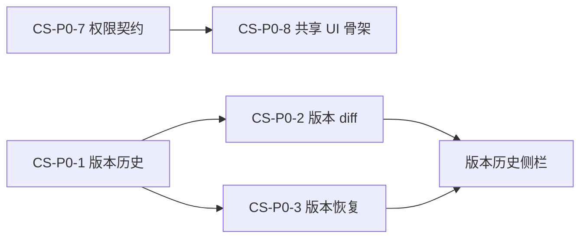

# CS-P0 工程卡（云共享与权限 · v1 零服务端）

> 配套：`docs/prd-cloud-sharing.md` v0.3（**契约已冻结**）· 日期 2026-10-17 · 产品：许清楚
> 拆卡依据：主理人决策 3「把 CS-P0-1/2/3/7 拆成可断言的工程卡」；CS-P0-7 按 **Q5=A + `allowSet`=档位上限 + `detach` 只断 grants + `policyCap`=effective** 四定稿编写。
> QA 对应：`scripts/sharing-merge-scan.mjs`（模型级、确定性、一键跑，纳入发布前门禁）。

## 0. 写卡规则（先读这段）

1. **验收标准必须可断言**。本文件**禁止**出现「功能正常」「体验良好」「权限正确」这类不可测表述；每条验收都是一个可写成 `expect(...)` 的命题。
2. **每条断言标注 [门禁] 或 [软指标]**。`[门禁]` = 不过即视为任务未完成；`[软指标]` = 记录数值，不阻塞合并。
3. **禁止新增依赖**（AGENTS 铁律 1.5）；**禁止 `window.prompt/alert`**（铁律 1.4）；**契约类型只进 `packages/core/src/contracts/`**（铁律 1.1）。
4. **纯函数必须纯**：不 mutate 入参、幂等、无 I/O、无 Date.now 隐式依赖（时间由入参传）。
5. 四张卡的总门禁命令：
   ```bash
   CODEBUDDY_SAFE_DELETE_ENABLED=0 pnpm build
   pnpm typecheck
   pnpm test
   node scripts/sharing-merge-scan.mjs   # QA 提供后接入
   ```

---

## CS-P0-1 本地版本历史（保存即版本）

### 输入
| 项 | 类型 / 来源 |
|---|---|
| 保存事件 | `{ docPath, module: 'writer'\|'sheet'\|'slide', model, trigger: 'explicit'\|'autosave'\|'close' }` |
| 保留策略 | `{ maxAgeDays: 30, maxVersionsPerFile: 100 }`（§2.1 缺省，可被团队/组织覆盖） |
| 作者信息 | `{ userId, deviceId }`（本地账户，T7.1） |
| 版本库位置 | v1：`userData/versions/<fileKey>/`（**集中存放**，Q8=C 的 v1 侧） |

### 输出
| 项 | 形状 |
|---|---|
| 版本记录 | `{ versionId, seq, createdAt, authorUserId, deviceId, summary, sizeBytes, parentVersionId, contentHash }` |
| 快照 | 内容寻址存储（`contentHash` 相同则**只存一份**） |
| 索引 | `userData/versions/<fileKey>/index.json`（原子写：临时文件 + rename） |

### 验收断言
| # | 断言 | 级别 |
|---|---|---|
| 1 | 同文档连续 **显式保存 10 次** → `versions.length === 10`，且 `seq` 严格为 `1..10`（无跳号、无重复） | [门禁] |
| 2 | `trigger === 'autosave'` 保存 10 次 → `versions.length` **不变**（Q4=A：自动保存 = 草稿，不产生版本） | [门禁] |
| 3 | `trigger === 'close'`（关闭确认保存）→ `versions.length === 1` | [门禁] |
| 4 | 取第 N 版快照反序列化 → 与当时保存的 `model` **deepEqual** | [门禁] |
| 5 | 相同内容连续保存两次 → `versions.length +2`，但两次 `contentHash` 相等，且**版本库字节增量 === 0**（去重生效） | [门禁] |
| 6 | 杀掉进程后重启 → 版本列表可读，`index.json` **不损坏**（原子写验证：写一半中断后仍读到旧索引） | [门禁] |
| 7 | 文件 X 的 `fileKey` 与同名不同路径的文件 Y **不同** → 版本互不串 | [门禁] |
| 8 | 索引损坏（人工写坏 json）→ **降级为"无历史"并提示**，**不得崩溃、不得删除原文档** | [门禁] |
| 9 | 保留策略：造 105 个版本 → 保留 **100** 个；其中 3 个为**命名版本（tag）** → 这 3 个**必在**保留集合内 | [门禁] |
| 10 | 50 MB 文档保存一次，版本写入耗时 | [软指标] 记录数值 |

### 依赖
- 无（零服务端）。可与 `todo.md` T7.1（本地账户）并行；`deviceId/authorUserId` 在 T7.1 落地前用占位值。

### 明确不做（防范围蔓延）
- 不做跨机同步（v1.5 侧车 `.jkversion` 才做）
- 不做 WPS 式定时快照（Q4=A）

---

## CS-P0-2 版本对比（diff）

### 输入
| 项 | 类型 |
|---|---|
| 左/右快照 | 由 CS-P0-1 的 `versionId` 取出的模型（`JkDocument` / `JkWorkbook` / `JkPresentation`） |
| 选项 | `{ ignoreWhitespace?: boolean; module }` |

### 输出
```ts
interface DiffHunk {
  type: 'insert' | 'delete' | 'change' | 'move' | 'structural';
  path: string;            // writer: 'body[3]' ; sheet: 'Sheet1!B7' ; slide: 'slide[2].shape[5]'
  before?: string; after?: string;
  detail?: { kind: 'value'|'formula'|'style'|'rowInsert'|'colDelete'|... };
}
interface DiffResult {
  module: 'writer'|'sheet'|'slide';
  summary: { added: number; removed: number; changed: number; moved: number };
  hunks: DiffHunk[];
}
```

### 验收断言
| # | 断言 | 级别 |
|---|---|---|
| 1 | 两版本**完全相同** → `hunks.length === 0` 且 `summary` 全 0 | [门禁] |
| 2 | Writer：改 1 个段落的 2 个词 → `hunks.length === 1`，`type==='change'`，词级差异**恰好覆盖这 2 个词** | [门禁] |
| 3 | Writer：新增 3 段 → `summary.added === 3` 且 `hunks` 均 `type==='insert'` | [门禁] |
| 4 | Writer：仅**移动**段落位置（内容不变）→ `type==='move'`，且**不计入** `added`/`removed` | [门禁] |
| 5 | Writer：删除 1 段 + 改另 1 段 → `removed===1 && changed===1`（互不吞并） | [门禁] |
| 6 | Sheet：改 1 个单元格**值** → `changed===1`，`path` 精确等于 `"Sheet1!B7"`，`detail.kind==='value'` | [门禁] |
| 7 | Sheet：改公式不改结果 → `detail.kind==='formula'`（**与 value 区分**） | [门禁] |
| 8 | Sheet：仅改背景色 → `detail.kind==='style'` | [门禁] |
| 9 | Sheet：插入 1 行 → 产出 `type==='structural'` 条目，`detail.kind==='rowInsert'`，**不被展开成 N 个单元格 change** | [门禁] |
| 10 | Slide：改第 3 页第 5 个形状的文本 → `path` 精确含 `slide[2].shape[5]`（0 基） | [门禁] |
| 11 | 对称性：`diff(a,b).summary.added === diff(b,a).summary.removed` | [门禁] |
| 12 | 纯度：调用两次结果 deepEqual；入参模型**未被 mutate** | [门禁] |
| 13 | 100 页文档 diff 耗时 | [软指标] 记录数值 |

### 依赖
- **CS-P0-1**（需要两个快照）

---

## CS-P0-3 版本恢复（append-only）

### 输入
| 项 | 类型 |
|---|---|
| 目标版本 | `versionId` |
| 当前文档 | 可写路径 + 当前模型 |
| 确认 | 用户经 **`Modal`** 二次确认（禁 `window.confirm`） |

### 输出
- **一个新版本**（`seq = N+1`），其 `contentHash === 目标版本.contentHash`，`parentVersionId = 当前最新版本`
- 历史**零删除**（append-only）

### 验收断言
| # | 断言 | 级别 |
|---|---|---|
| 1 | 恢复 v3 → 版本总数 `N+1`，新版本 `contentHash === v3.contentHash` | [门禁] |
| 2 | 恢复后 `versions.length === N+1`（**历史一条不少**） | [门禁] |
| 3 | 恢复后预览新版本 → deepEqual v3 快照 | [门禁] |
| 4 | 再恢复一次 v3 → **再 +1 版**（append-only，不因内容相同去重**记录**；快照字节可复用） | [门禁] |
| 5 | 用户点「取消」→ `versions.length` 不变、文档内容不变 | [门禁] |
| 6 | 恢复指定一个**已被保留策略清理**的版本 → 明确报错「版本已清理」，**不得静默恢复成最新版** | [门禁] |
| 7 | 全流程**无** `window.confirm` / `window.prompt` / `window.alert`（静态扫描 + 运行时 spy） | [门禁] |

### 依赖
- **CS-P0-1**；UI 依赖项目 `Modal`（portal 到 `#root`，AGENTS 铁律 1.4 / 1.8 改后跑 GUI 冒烟）

---

## CS-P0-7 权限契约 + 求解纯函数（**契约已冻结，按此实现**）

> ⚠️ 本卡是**发布前门禁的硬断言载体**。四条越权反证（用例 **4 / 9 / 10 / 15**）任一不过 = 直接打回，不进入下一轮。

### 输入
```ts
resolvePermissions(
  user: { id: string; teamIds: string[] },
  chain: ShareNode[],      // 根 → 目标；node.policyCap 必须是 effective
  via: ShareVia            // {kind:'member'} | {kind:'link'; id; passwordOk?}
): Set<ShareCapability>

resolveAccess(user, chain, entry):        // 成员经链接进入 → union(member, link)
buildChain(nodesById, fileId): ShareNode[] // 环检测 + 断链 + 顺序 + effectiveCap 计算
```

### 输出
- `Set<ShareCapability>`（不可 mutate、不可共享引用）
- 契约类型文件：`packages/core/src/contracts/sharing.ts`（**单一事实源**）

### 四条**不可妥协**的越权硬断言（主理人点名）

| 用例 | 断言（可直接写成 expect） | 越权类型 |
|---|---|---|
| **4** | 父 deny `download` + 子授 Viewer ⇒ `result.has('download') === false`，且 `result` 仍含 `open`/`print`/`export` | **deny 不可逆被违反**（Q5=A） |
| **9** | 根 `owner` → 子 `commenter`(effective) → 文件授 `editor` ⇒ `result` **deepEqual** `capabilitiesOf('commenter')` | **grant 回弹突破祖先上限** |
| **10** | 组织 `denied=['print','export']`（effective 继承）→ 文件授 editor、该文件 `denied=[]` ⇒ `result.has('print')===false && result.has('export')===false` | **组织强制禁项被 grant 加回** |
| **15** | 祖先 deny `download` → 子级授 Editor → 孙级再授 Owner ⇒ `result.has('download') === false` | **跨层不可逆被违反** |

### 全量验收断言（25 条，编号同 PRD §4.4 用例表）

| # | 断言要点 | 级别 |
|---|---|---|
| 1–2 | 授权侧 union（团队 Viewer + 团队 Editor ⇒ Editor；直接 Viewer + 团队 Editor ⇒ Editor） | [门禁] |
| 3 | 同主体同时命中 grants 与 denies ⇒ deny 胜 | [门禁] |
| **4** | **见上表** | [门禁] |
| 5 | `policyCap.maxRole='commenter'` + 文件授 Editor ⇒ deepEqual `capabilitiesOf('commenter')` | [门禁] |
| 6 | `linkSharingEnabled:false` + `via=link` ⇒ `size === 0` | [门禁] |
| 7 | 用户非任何授权主体 ⇒ `size === 0` | [门禁] |
| 8 | 链接授 Editor + `via=link` ⇒ deepEqual `capabilitiesOf('commenter')` | [门禁] |
| **9** | **见上表** | [门禁] |
| **10** | **见上表** | [门禁] |
| 11 | `via=member` 且 chain 含 `anyone`/`link` ⇒ `size === 0` | [门禁] |
| 12 | 非法 role / 非法 capability / 非法 `maxRole` ⇒ **不抛异常**且结果收敛（∅ 或忽略该条） | [门禁] |
| 13 | `teamIds` 含不存在团队 ⇒ 忽略该主体，不报错不放行 | [门禁] |
| 14 | 两次调用 deepEqual；入参**深比较不变**（纯度） | [门禁] |
| **15** | **见上表** | [门禁] |
| 16 | 环状 `parentId` ⇒ `buildChain` 返回 `[]`，且**耗时 < 10 ms**（无死循环） | [门禁] |
| 17 | `detachedFromParent` ⇒ 祖先 grants 不入链；祖先 denies / policyCap **仍生效** | [门禁] |
| 18 | `nodesById` 缺父节点 ⇒ 链根终止，不报错不放行 | [门禁] |
| 19 | 有 `linkPolicy` 但 `via=member` ⇒ `linkPolicy` 不参与 | [门禁] |
| 20 | 链接 `passwordOk:false` ⇒ `size === 0` | [门禁] |
| 21 | 成员(团队 Editor) 经公网链接(Viewer) ⇒ `resolveAccess` deepEqual `capabilitiesOf('editor')` | [门禁] |
| 22 | 无该文件授权的成员经 Viewer 链接 ⇒ deepEqual `capabilitiesOf('viewer')` | [门禁] |
| 23 | 组织 deny download + 成员经链接 ⇒ 并集仍无 download | [门禁] |
| 24 | 单调性守卫：`∀ r1>r2: capabilitiesOf(r1) ⊇ capabilitiesOf(r2)`；`capabilitiesOf('none')` 为**空集** | [门禁] |
| 25 | `buildChain` 返回节点的 `policyCap` 是 **effective**（含组织上限），非 raw | [门禁] |

### 五条实现约束（照抄即不会带上 P0 越权，详见 PRD §4.4）

1. `policyCap` 封顶必须覆盖**整条祖先链**（`allowed &= allowSet(...)` 在循环内累积）。
2. `policyCap.denied` 必须**实际应用**（`denied |= cap.denied`）。
3. **deny 不可逆**：拒绝集**先累积、最后统一作差**（任何"逐级先并集再差集"都会让子级翻案）。
4. **链接通路门控**：`linkSharingEnabled===false` 或 `passwordOk!==true` ⇒ 直接 ∅。
5. **`policyCap` 存 `effective`**（三级 min 已算好），禁止存 raw —— 否则深层 grant 回弹。

### 额外约束
| 项 | 要求 | 级别 |
|---|---|---|
| 纯度 | 无 I/O、无 `Date.now()`、无随机；不 mutate 入参 | [门禁] |
| 性能 | 20 节点链单次求解 | [软指标] 记录数值（目标 < 1 ms） |
| 缓存键 | 含 `via.kind + via.id + passwordOk`（防串权） | [门禁]（若实现缓存） |
| 契约位置 | 仅 `packages/core/src/contracts/sharing.ts`，别处 `import` | [门禁] |

### 依赖
- 无外部依赖（纯类型 + 纯函数）。
- QA 的 `scripts/sharing-merge-scan.mjs` 是本卡的**验收组成**，需与本卡同时可跑。
- ⚠️ **不在本卡范围**：云端 ACL 存储、UI 权限面板（属 CS-P1-5 / CS-P2-3）。

---

## 汇总：四卡依赖与门禁



| 卡 | 依赖 | 是否可立即开工 | 主要风险 |
|---|---|---|---|
| CS-P0-1 | 无 | ✅ | 原子写/去重；大文件耗时 |
| CS-P0-2 | CS-P0-1 | ⏳ 等 CS-P0-1 | diff 粒度定义（移动/结构变更易与增删混淆） |
| CS-P0-3 | CS-P0-1 | ⏳ 等 CS-P0-1 | 已清理版本的错误路径不得静默 |
| CS-P0-7 | 无 | ✅ | **四条越权反证**（4/9/10/15） |

## 给 QA 的对接说明

1. 本文件每条 [门禁] 断言即为探针口径，可直接映射成 `scripts/sharing-merge-scan.mjs` 的用例；用例编号与 PRD §4.4 表**一一对应**，便于双向追溯。
2. 用例 4 与 15、用例 9 与 10 是**成对防线**（正向 + 回归），**不得因"看起来重复"而合并**。
3. 若实现选择"成员经链接 = 取并集"以外的方案，用例 21–23 必须同步改 —— **改产品先改本文，不要改测试迁就实现**。
